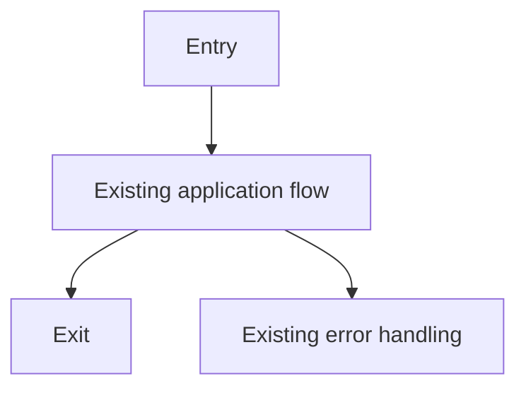

# Code Review Report

## Report Location
- Saved file: `.codex/docs/reviews/review-20260217-094228.md`

## TL;DR
- No code changes are present relative to `main` or in the working tree.
- No implementation risk can be evaluated because there is no patch.
- Merge recommendation: `approve` from a review perspective, contingent on confirming the correct workspace/branch was reviewed.

## High-Level Change Story
- Scope: No files changed in this workspace.
- Intent: Not inferable from code because no diff exists.
- Approach: `git --no-pager diff main...HEAD` then fallback `git --no-pager diff`.
- Primary risk theme: Review blind spot risk if the intended changes are in another worktree/branch.

## Acceptance Criteria Status
| Criterion | Status | Evidence |
| --- | --- | --- |
| Acceptance criteria validated against implementation | unverifiable | No changed files or patch in current workspace |

## Change Overview
| File | Type | Purpose | Key Change |
| --- | --- | --- | --- |
| N/A | N/A | N/A | No changed files detected |

## Execution Flow Impact
### Current vs Changed Paths
| Path ID | Scenario | Current Path | Changed Path | Impact |
| --- | --- | --- | --- | --- |
| P1 | Any runtime request | `<entry -> existing code -> exit>` | `<entry -> existing code -> exit>` | No behavioral delta |
| P2 | Error/edge handling | `<entry -> existing error path>` | `<entry -> existing error path>` | No behavioral delta |

### Affected Code Paths
| Path ID | Code Path | Notes |
| --- | --- | --- |
| P1 | N/A | No touched functions/classes |
| P2 | N/A | No touched functions/classes |

### Flow Diagram

## Backward Compatibility
| Area | Status | Potential Breakage | Mitigation |
| --- | --- | --- | --- |
| Data/Schema | compatible | None observed (no change) | None required |
| API/Contracts | compatible | None observed (no change) | None required |
| Jobs/Async | compatible | None observed (no change) | None required |
| Notifications/Events | compatible | None observed (no change) | None required |
| Integrations | compatible | None observed (no change) | None required |

## Test Coverage Assessment
- New code tested: N/A (no new code)
- Test quality: N/A
- Missing tests: N/A

## UI Design Checklist (If Applicable)
| Item | Status | Evidence |
| --- | --- | --- |
| Prior art/component reuse checked | N/A | No UI changes |
| Spec fidelity (spacing/sizing/edge cases) | N/A | No UI changes |
| Responsive 320px-3000px | N/A | No UI changes |
| Touch usability | N/A | No UI changes |
| Accessibility (tab/focus/labels/semantic HTML) | N/A | No UI changes |
| Context coverage (sidebar/surfaces/etc.) | N/A | No UI changes |
| Localization | N/A | No UI changes |
| Screenshots/videos provided | N/A | No UI changes |

## Pre-Merge Checklist
| Check | Status | Evidence |
| --- | --- | --- |
| Acceptance criteria complete | unverifiable | No patch to validate |
| No debug leftovers | yes | No changed lines in workspace |
| Tests green | unverifiable | No target patch to validate test scope |
| New tests for new behavior | N/A | No new behavior introduced |
| Migrations/backfills safe | N/A | No migration changes in this workspace |
| Query/index/pagination concerns addressed | N/A | No query-affecting changes |
| Docs/readme updated if major change | N/A | No major change present |

## Design Notes (Only Noteworthy)
- Strengths: Clean baseline repository state in this workspace simplifies verification.
- Concerns: Possible mismatch between intended review target and current workspace/branch.

## Suggested Review Comments (Conventional Format)
- `praise: Clean workspace with zero diff made baseline verification deterministic.`
- `question: Should this review target a different worktree/branch where the implementation exists?`

## Final File Coverage Table
| File | Risk | Commented | Why No Comment | What Is Good |
| --- | --- | --- | --- | --- |
| N/A | low | no | No files changed, so per-file comments are not applicable | Repository state is clean and reviewable |

## Review Comment Inventory
| ID | Label | Severity | File:Line | Comment | Suggested Change |
| --- | --- | --- | --- | --- | --- |
| C1 | `question` | low | N/A | No patch exists in current workspace; confirm intended branch/worktree. | Re-run review against the branch containing the implementation diff. |

## Final Verdict
- approve

