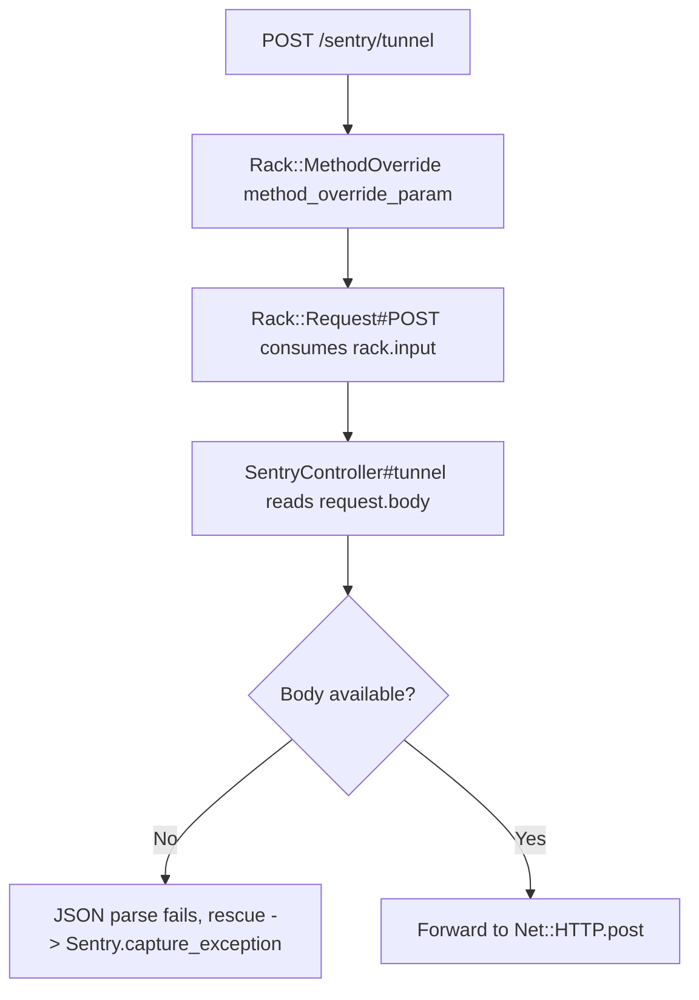

# Code Review Report

## Report Location
- Saved file: `.codex/docs/reviews/review-20260218-112651.md`

## TL;DR
- The branch only changes dependency resolution in `Gemfile.lock`, but introduces two behavior regressions tied to Rack 3 semantics.
- `SentryController#tunnel` reads an already-consumed request body under `application/x-www-form-urlencoded` POSTs, causing parsing to fail before forwarding.
- Pagination link key encoding changed (`[`/`]` now percent-encoded), breaking tests and potentially external URL-format expectations.
- Merge recommendation: request changes (regressions are test-visible and user-visible at API link-string level).

## High-Level Change Story
- Scope: Dependency lock updates (`rack` 2.2.21 -> 3.2.5 plus related gems).
- Intent: Modernize rack stack.
- Approach: Lockfile-only update, no direct application code changes.
- Primary risk theme: Runtime behavior shifts from Rack internals (request-body handling and query serialization) that existing app/test code relies on.

## Acceptance Criteria Status
| Criterion | Status | Evidence |
| --- | --- | --- |
| Preserve Sentry tunnel forwarding behavior | partial | `test/integration/sentry_controller_test.rb:9` fails after lockfile update |
| Preserve Sentry exception-capture expectation path | missing | `test/integration/sentry_controller_test.rb:34` captures different exception than expected |
| Preserve pagination link key format contract | missing | `test/lib/action_json_api/pagination_links_test.rb:24`, `test/lib/action_json_api/pagination_links_test.rb:48` |
| Full acceptance criteria provided by ticket/spec | unverifiable | No explicit ticket/criteria provided in context |

## Change Overview
| File | Type | Purpose | Key Change |
| --- | --- | --- | --- |
| `Gemfile.lock` | dependency lock | Update runtime/test dependency graph | `rack` upgraded to `3.2.5` and transitive ecosystem changes |

## Per-File Comment Plan
- `Gemfile.lock` -> high risk -> verify behavioral compatibility of HTTP parsing/encoding assumptions.
- `app/controllers/sentry_controller.rb` -> high risk (integration boundary) -> validate request body semantics and error-capture behavior under upgraded rack.
- `lib/action_json_api/base_controller/pagination_links.rb` -> medium risk (shared API serialization) -> validate URL encoding contract stability.
- `test/integration/sentry_controller_test.rb` -> medium risk -> ensure tests represent real content-type/body semantics.
- `test/lib/action_json_api/pagination_links_test.rb` -> medium risk -> ensure expectations reflect intended external contract.

## Execution Flow Impact
### Current vs Changed Paths
| Path ID | Scenario | Current Path | Changed Path | Impact |
| --- | --- | --- | --- | --- |
| P1 | Sentry tunnel POST in integration test default content type | `rack method override inspects POST -> rack rewinds input -> controller reads full envelope -> Net::HTTP.post` | `rack method override inspects POST -> rack does not rewind input -> controller reads empty body -> JSON parse path fails` | Upstream request not sent in this request shape |
| P2 | Pagination link generation for nested params | `build_pagination_links -> Rack::Utils.build_nested_query -> bracket keys preserved` | `build_pagination_links -> Rack::Utils.build_nested_query -> bracket keys encoded as %5B/%5D` | String-format contract changed for generated links |

### Affected Code Paths
| Path ID | Code Path | Notes |
| --- | --- | --- |
| P1 | `app/controllers/sentry_controller.rb:8` -> `app/controllers/sentry_controller.rb:10` -> `app/controllers/sentry_controller.rb:17` | Controller expects unread body; now receives consumed stream in form-encoded POST path |
| P1 | `/home/felix/.rbenv/versions/3.4.5/lib/ruby/gems/3.4.0/gems/rack-3.2.5/lib/rack/method_override.rb:49` -> `/home/felix/.rbenv/versions/3.4.5/lib/ruby/gems/3.4.0/gems/rack-3.2.5/lib/rack/request.rb:519` | Middleware triggers `req.POST`; Rack 3 reads body and no rewind here |
| P2 | `lib/action_json_api/base_controller/pagination_links.rb:17` -> `/home/felix/.rbenv/versions/3.4.5/lib/ruby/gems/3.4.0/gems/rack-3.2.5/lib/rack/utils.rb:134` | Query-key encoding behavior changed in Rack |

### Flow Diagram

## Backward Compatibility
| Area | Status | Potential Breakage | Mitigation |
| --- | --- | --- | --- |
| Data/Schema | compatible | None observed | N/A |
| API/Contracts | conditional | Pagination URLs now emit encoded bracket keys; clients/tests comparing literal strings may fail | Decide canonical URL format and normalize serializer/tests accordingly |
| Jobs/Async | compatible | None observed | N/A |
| Notifications/Events | compatible | None observed | N/A |
| Integrations | conditional | Sentry tunnel behavior depends on request content type/body stream state | Ensure tunnel handling does not depend on pre-read state and align request content-type expectations |

## Test Coverage Assessment
- New code tested: N/A (no app code changes)
- Test quality: Medium for detecting regressions, but one Sentry test shape likely relies on legacy body rewind behavior.
- Missing tests:
  - Sentry tunnel request with explicit non-form content type (e.g., `text/plain` or sentry envelope type).
  - Sentry tunnel behavior when rack input has already been consumed (defensive handling).
  - API contract test clarifying whether bracketed query keys must remain human-readable or may be RFC-encoded.

## Pre-Merge Checklist
| Check | Status | Evidence |
| --- | --- | --- |
| Acceptance criteria complete | partial | Regressions present in existing suite |
| No debug leftovers | yes | Lockfile-only branch diff |
| Tests green | no | Failures in `test/integration/sentry_controller_test.rb`, `test/lib/action_json_api/pagination_links_test.rb` |
| New tests for new behavior | no | No tests added for rack3-specific semantic changes |
| Migrations/backfills safe | N/A | No migration changes |
| Query/index/pagination concerns addressed | partial | Pagination encoding changed without contract decision |
| Docs/readme updated if major change | no | No behavior-change notes found for dependency-driven contract shifts |

## Suggested Review Comments (Conventional Format)
- `issue (blocking): Sentry tunnel depends on rack input rewind behavior removed by Rack 3`
  - File: `app/controllers/sentry_controller.rb:8`
  - Impact: Under form-encoded POST paths, request body may already be consumed before controller logic runs, causing parse failures and missed upstream forwarding.
  - Suggested change: Make tunnel robust to pre-consumed body/read semantics and align expected inbound content type.

- `issue (blocking): Pagination link format contract changed after Rack upgrade`
  - File: `lib/action_json_api/base_controller/pagination_links.rb:17`
  - Impact: Generated links now encode nested key brackets (`%5B`/`%5D`), violating current test contract and potentially external consumer expectations.
  - Suggested change: Explicitly choose and enforce canonical link format (encoded or bracket-literal) and update serializer/tests consistently.

- `question: Should Sentry tunnel accept form-encoded payloads as a supported contract?`
  - File: `test/integration/sentry_controller_test.rb:6`
  - Why: Current tests use default form content type; production SDK behavior may differ (often non-form content type). Contract should be explicit.

- `praise: Dependency-only branch isolates risk to runtime behavior changes`
  - File: `Gemfile.lock`
  - Why: No app code churn made regression triage straightforward.

## Final File Coverage Table
| File | Risk | Commented | Why No Comment | What Is Good |
| --- | --- | --- | --- | --- |
| `Gemfile.lock` | high | yes | N/A | Clean, isolated dependency update scope |
| `app/controllers/sentry_controller.rb` | high | yes | N/A | Simple tunnel flow and explicit host/project allowlist checks |
| `lib/action_json_api/base_controller/pagination_links.rb` | medium | yes | N/A | Centralized pagination-link construction in one module |
| `test/integration/sentry_controller_test.rb` | medium | yes | N/A | Tests capture both positive path and invalid DSN safeguards |
| `test/lib/action_json_api/pagination_links_test.rb` | medium | yes | N/A | Tests cover key encoding, injection hardening, and URL value encoding |

## Review Comment Inventory
| ID | Label | Severity | File:Line | Comment | Suggested Change |
| --- | --- | --- | --- | --- | --- |
| C1 | `issue (blocking)` | high | `app/controllers/sentry_controller.rb:8` | Reads body stream assuming unread state; Rack 3 middleware chain may consume it first for form POSTs. | Make body extraction resilient (e.g., raw_post/reset semantics or contract-enforced content type). |
| C2 | `issue (blocking)` | high | `lib/action_json_api/base_controller/pagination_links.rb:17` | Delegation to `Rack::Utils.build_nested_query` now emits encoded nested keys. | Decide desired canonical encoding and serialize accordingly independent of rack defaults. |
| C3 | `question` | low | `test/integration/sentry_controller_test.rb:6` | Test uses implicit form content type that may not match real Sentry envelope requests. | Clarify/encode intended content type in tests and endpoint contract. |

## Final Verdict
- request changes

## Evidence Appendix
- Failing tests reproduced:
  - `bin/rails test test/integration/sentry_controller_test.rb -v`
  - `bin/rails test test/lib/action_json_api/pagination_links_test.rb -v`
- Rack 3 encoding change explicitly documented:
  - `/home/felix/.rbenv/versions/3.4.5/lib/ruby/gems/3.4.0/gems/rack-3.2.5/CHANGELOG.md:382`
- Rack 3 request-body parse path consumes form body without rewinding before controller read:
  - `/home/felix/.rbenv/versions/3.4.5/lib/ruby/gems/3.4.0/gems/rack-3.2.5/lib/rack/request.rb:519`
- Controlled reproduction (test env) showed:
  - default form content type -> `request.body.read` observed as empty in tunnel action
  - explicit `text/plain` content type -> envelope body available in tunnel action
