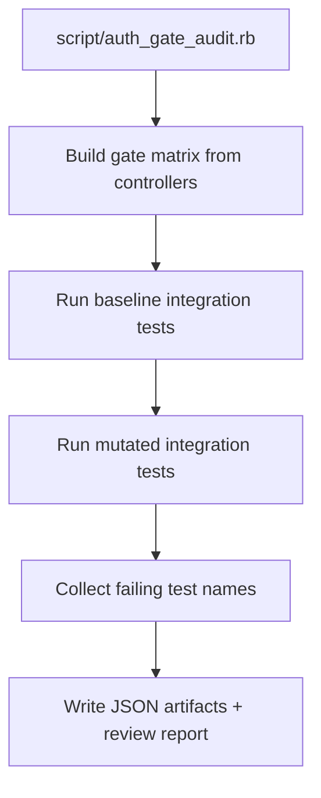

# Code Review Report

## Report Location
- Saved file: `.codex/docs/reviews/review-20260220-070954.md`

## TL;DR
- Audited 8 auth gate mutation cases across 4 auth-gated controllers.
- Covered: 0; Missing: 0; Unverified: 0; Error: 0.
- Authorization integration consistency status: merge-ready.

## High-Level Change Story
- Scope: Integration authorization gates in controllers under `app/controllers/**/*_controller.rb` that have matching files under `test/integration`.
- Intent: Verify each hard/soft gate has an integration test that actually fails when the gate is invalidated.
- Approach: Per-case runtime mutation via `AUTH_GATE_MUTATION_B64` + full controller integration test file execution.
- Primary risk theme: Gates that mutate cleanly without any failing integration test indicate missing or ineffective coverage.

## Acceptance Criteria Status
| Criterion | Status | Evidence |
| --- | --- | --- |
| Gate matrix generated for all auth-gated integration controllers | met | `tmp/auth_gate_audit/gate_matrix.json` |
| Mutation verification executed per gate case | met | `tmp/auth_gate_audit/mutation_results.json` |
| Missing / duplicate / never-fail signals reported | met | `tmp/auth_gate_audit/mutation_results.json` |

## Findings (Ordered by Severity)
- No blocking findings discovered in the mutation-driven authorization gate audit.

## Change Overview
| File | Type | Purpose | Key Change |
| --- | --- | --- | --- |
| `test/support/auth_gate_mutation.rb` | test support | Runtime gate mutation hook | Applies callsite/scope mutations when `AUTH_GATE_MUTATION_B64` is set. |
| `script/auth_gate_audit.rb` | script | Automated gate audit runner | Builds gate matrix, runs mutations, writes JSON artifacts and review report. |

## Execution Flow Impact
### Current vs Changed Paths
| Path ID | Scenario | Current Path | Changed Path | Impact |
| --- | --- | --- | --- | --- |
| P1 | Baseline integration run | `rails test -> controller gate -> response` | unchanged | Serves as green baseline for attribution. |
| P2 | Mutation verification | N/A | `rails test + AUTH_GATE_MUTATION_B64 -> mutated gate -> failing assertions` | Identifies missing/weak gate coverage. |

### Affected Code Paths
| Path ID | Code Path | Notes |
| --- | --- | --- |
| P1 | `test/test_helper.rb` -> `test/support/auth_gate_mutation.rb` | Mutation hook loads only when env var is present. |
| P2 | `script/auth_gate_audit.rb` -> `bundle exec rails test` | Orchestrates per-case mutation and result capture. |

### Flow Diagram

## File Coverage Summary
| Controller | Test File | Gate Cases | Covered | Missing | Unverified | Error |
| --- | --- | --- | --- | --- | --- | --- |
| `app/controllers/api/v2/component_relationships/monitoring_lists_controller.rb` | `test/integration/api/v2/component_relationships/monitoring_lists_controller_test.rb` | 2 | 0 | 0 | 0 | 0 |
| `app/controllers/api/v2/component_relationships/notifications_controller.rb` | `test/integration/api/v2/component_relationships/notifications_controller_test.rb` | 2 | 0 | 0 | 0 | 0 |
| `app/controllers/api/v2/component_request_relationships/components_controller.rb` | `test/integration/api/v2/component_request_relationships/components_controller_test.rb` | 2 | 0 | 0 | 0 | 0 |
| `app/controllers/api/v2/component_request_relationships/memberships_controller.rb` | `test/integration/api/v2/component_request_relationships/memberships_controller_test.rb` | 2 | 0 | 0 | 0 | 0 |

## Baseline Test Stability
| Test File | Baseline Status | Failing Tests |
| --- | --- | --- |
| `test/integration/api/v2/component_relationships/monitoring_lists_controller_test.rb` | pass | - |
| `test/integration/api/v2/component_relationships/notifications_controller_test.rb` | pass | - |
| `test/integration/api/v2/component_request_relationships/components_controller_test.rb` | pass | - |
| `test/integration/api/v2/component_request_relationships/memberships_controller_test.rb` | pass | - |

## Controllers with Integration Tests but No Explicit Auth Gates
- `app/controllers/api/v2/api_tokens_controller.rb`
- `app/controllers/api/v2/consumption_reports_controller.rb`
- `app/controllers/api/v2/exports_controller.rb`
- `app/controllers/api/v2/sessions_controller.rb`
- `app/controllers/auth0_controller.rb`
- `app/controllers/documentation_controller.rb`
- `app/controllers/sentry_controller.rb`
- `app/controllers/siemens_id_controller.rb`
- `app/controllers/storage/monitoring_list_exports_controller.rb`

## Residual Risks
- Mutation checks operate at runtime patch points; if a gate is enforced by unrelated path constraints, signal can be noisy.
- Duplicate-case detection is based on identical failing-test sets, which is heuristic.