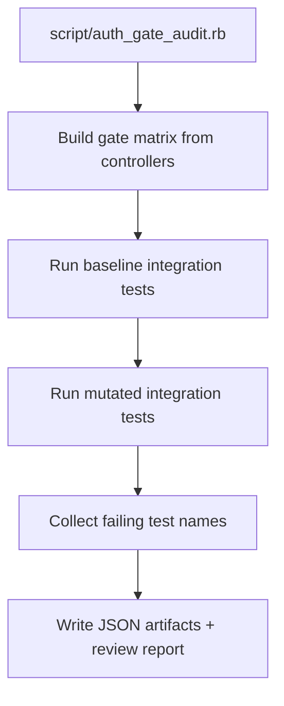

# Code Review Report

## Report Location
- Saved file: `.codex/docs/reviews/review-20260220-072443.md`

## TL;DR
- Audited 49 auth gate mutation cases across 20 auth-gated controllers.
- Covered: 49; Missing: 0; Unverified: 0; Error: 0.
- Authorization integration consistency status: merge-ready.

## High-Level Change Story
- Scope: Integration authorization gates in controllers under `app/controllers/**/*_controller.rb` that have matching files under `test/integration`.
- Intent: Verify each hard/soft gate has an integration test that actually fails when the gate is invalidated.
- Approach: Per-case runtime mutation via `AUTH_GATE_MUTATION_B64` + full controller integration test file execution.
- Primary risk theme: Gates that mutate cleanly without any failing integration test indicate missing or ineffective coverage.

## Acceptance Criteria Status
| Criterion | Status | Evidence |
| --- | --- | --- |
| Gate matrix generated for all auth-gated integration controllers | met | `tmp/auth_gate_audit/gate_matrix.json` |
| Mutation verification executed per gate case | met | `tmp/auth_gate_audit/mutation_results.json` |
| Missing / duplicate / never-fail signals reported | met | `tmp/auth_gate_audit/mutation_results.json` |

## Findings (Ordered by Severity)

### suggestion (non-blocking): Duplicate mutation signal in `test/integration/api/v2/component_relationships/monitoring_lists_controller_test.rb`
- Gate cases: `app/controllers/api/v2/component_relationships/monitoring_lists_controller.rb:22:callsite_forbid`, `app/controllers/api/v2/component_relationships/monitoring_lists_controller.rb:23:class_scope_none:Component.visible`
- Identical failing tests: `Api::V2::ComponentRelationships::MonitoringListsController::Authorization::IndexTest#test_read:components_and_a_monitoring_list_read_permission_are_required_to_return_relations`, `Api::V2::ComponentRelationships::MonitoringListsController::Authorization::IndexTest#test_read:owned:monitoring_lists_or_read:org:monitoring_lists_are_sufficient_to_view_ML_relations`, `Api::V2::ComponentRelationships::MonitoringListsController::IndexTest#test_GET_/components/:id/relationships/monitoringLists_(with_included_monitoringLists)_returns_all_related_MLs_as_included`, `Api::V2::ComponentRelationships::MonitoringListsController::IndexTest#test_GET_/components/:id/relationships/monitoringLists_(without_includes)_does_not_return_includes_`, `Api::V2::ComponentRelationships::MonitoringListsController::IndexTest#test_GET_/components/:id/relationships/monitoringLists_SCHEMA_(with_included_monitoringLists)`, `Api::V2::ComponentRelationships::MonitoringListsController::IndexTest#test_GET_/components/:id/relationships/monitoringLists_SCHEMA_(without_includes)`, `Api::V2::ComponentRelationships::MonitoringListsController::IndexTest#test_GET_/components/:id/relationships/monitoringLists_accepts_supported_JSON:API_params_without_error`, `Api::V2::ComponentRelationships::MonitoringListsController::IndexTest#test_GET_/components/:id/relationships/monitoringLists_allows_to_restrict_the_returned_fields_and_relationships_for_included_MLs`, `Api::V2::ComponentRelationships::MonitoringListsController::IndexTest#test_GET_/components/:id/relationships/monitoringLists_only_returns_UUIDs_of_visible_MLs`, `Api::V2::ComponentRelationships::MonitoringListsController::IndexTest#test_GET_/components/:id/relationships/monitoringLists_returns_all_visible_ML_relations_for_the_component`, `Api::V2::ComponentRelationships::MonitoringListsController::IndexTest#test_GET_/components/:id/relationships/monitoringLists_returns_an_empty_array_if_the_component_has_no_visible_ML_relations`, `Api::V2::ComponentRelationships::MonitoringListsController::IndexTest#test_GET_/components/:id/relationships/monitoringLists_returns_correct_links`, `Api::V2::ComponentRelationships::MonitoringListsController::IndexTest#test_GET_/components/:id/relationships/monitoringLists_returns_working_prev_and_next_links`, `Api::V2::ComponentRelationships::MonitoringListsController::IndexTest#test_GET_/components/:id/relationships/monitoringLists_with_a_non-existing_component_id_returns_a_404`
- Impact: These gates appear to be covered by overlapping tests only.
- Suggested fix: Consider consolidating overlapping auth tests if intent is identical.

### suggestion (non-blocking): Duplicate mutation signal in `test/integration/api/v2/component_relationships/notifications_controller_test.rb`
- Gate cases: `app/controllers/api/v2/component_relationships/notifications_controller.rb:22:callsite_forbid`, `app/controllers/api/v2/component_relationships/notifications_controller.rb:23:class_scope_none:Component.visible`
- Identical failing tests: `Api::V2::ComponentRelationships::NotificationsController::Authorization::IndexTest#test_read:components_and_read:notifications_permissions_are_required_to_return_notification_relations`, `Api::V2::ComponentRelationships::NotificationsController::IndexTest#test_GET_/components/:id/relationships/notifications_(with_included_notifications)_returns_all_related_notifications_as_included`, `Api::V2::ComponentRelationships::NotificationsController::IndexTest#test_GET_/components/:id/relationships/notifications_(without_includes)_does_not_return_includes_`, `Api::V2::ComponentRelationships::NotificationsController::IndexTest#test_GET_/components/:id/relationships/notifications_SCHEMA_(with_included_notifications)`, `Api::V2::ComponentRelationships::NotificationsController::IndexTest#test_GET_/components/:id/relationships/notifications_SCHEMA_(without_includes)`, `Api::V2::ComponentRelationships::NotificationsController::IndexTest#test_GET_/components/:id/relationships/notifications_accepts_supported_JSON:API_params_without_error`, `Api::V2::ComponentRelationships::NotificationsController::IndexTest#test_GET_/components/:id/relationships/notifications_allows_to_restrict_the_returned_fields_and_relationships_for_included_notifications`, `Api::V2::ComponentRelationships::NotificationsController::IndexTest#test_GET_/components/:id/relationships/notifications_returns_all_notification_relations_for_the_component`, `Api::V2::ComponentRelationships::NotificationsController::IndexTest#test_GET_/components/:id/relationships/notifications_returns_an_empty_array_if_the_component_has_no_notification_relations`, `Api::V2::ComponentRelationships::NotificationsController::IndexTest#test_GET_/components/:id/relationships/notifications_returns_correct_links`, `Api::V2::ComponentRelationships::NotificationsController::IndexTest#test_GET_/components/:id/relationships/notifications_with_a_non-existing_component_id_returns_a_404`
- Impact: These gates appear to be covered by overlapping tests only.
- Suggested fix: Consider consolidating overlapping auth tests if intent is identical.

### suggestion (non-blocking): Duplicate mutation signal in `test/integration/api/v2/component_request_relationships/components_controller_test.rb`
- Gate cases: `app/controllers/api/v2/component_request_relationships/components_controller.rb:21:callsite_forbid`, `app/controllers/api/v2/component_request_relationships/components_controller.rb:22:class_scope_none:ComponentRequest.visible`
- Identical failing tests: `Api::V2::ComponentRequestRelationships::ComponentsController::Authorization::ShowTest#test_read:authored:component_requests_and_read:components_are_required_to_return_component_data`, `Api::V2::ComponentRequestRelationships::ComponentsController::Authorization::ShowTest#test_read:org:component_requests_permission_is_sufficient_to_view_mapped_component`, `Api::V2::ComponentRequestRelationships::ComponentsController::ShowTest#test_GET_/componentRequests/:id/relationships/component_(with_included_component)_returns_the_component_as_included`, `Api::V2::ComponentRequestRelationships::ComponentsController::ShowTest#test_GET_/componentRequests/:id/relationships/component_(without_includes)_does_not_return_includes_`, `Api::V2::ComponentRequestRelationships::ComponentsController::ShowTest#test_GET_/componentRequests/:id/relationships/component_SCHEMA_(with_included_component)`, `Api::V2::ComponentRequestRelationships::ComponentsController::ShowTest#test_GET_/componentRequests/:id/relationships/component_SCHEMA_(without_includes)`, `Api::V2::ComponentRequestRelationships::ComponentsController::ShowTest#test_GET_/componentRequests/:id/relationships/component_allows_to_restrict_the_returned_fields_and_relationships_for_the_included_component`, `Api::V2::ComponentRequestRelationships::ComponentsController::ShowTest#test_GET_/componentRequests/:id/relationships/component_returns_nil_if_the_component_request_has_no_component_relation`, `Api::V2::ComponentRequestRelationships::ComponentsController::ShowTest#test_GET_/componentRequests/:id/relationships/component_returns_the_component_relation_for_the_component_request`, `Api::V2::ComponentRequestRelationships::ComponentsController::ShowTest#test_GET_/componentRequests/:id/relationships/component_with_a_non-existing_component_request_id_returns_a_404`
- Impact: These gates appear to be covered by overlapping tests only.
- Suggested fix: Consider consolidating overlapping auth tests if intent is identical.

### suggestion (non-blocking): Duplicate mutation signal in `test/integration/api/v2/component_request_relationships/memberships_controller_test.rb`
- Gate cases: `app/controllers/api/v2/component_request_relationships/memberships_controller.rb:21:callsite_forbid`, `app/controllers/api/v2/component_request_relationships/memberships_controller.rb:22:class_scope_none:ComponentRequest.visible`
- Identical failing tests: `Api::V2::ComponentRequestRelationships::MembershipsController::Authorization::ShowTest#test_read:authored:component_requests_and_read:org:memberships_are_required_to_return_the_membership_relation`, `Api::V2::ComponentRequestRelationships::MembershipsController::Authorization::ShowTest#test_read:org:component_requests_permission_is_sufficient_to_view_requester_membership`, `Api::V2::ComponentRequestRelationships::MembershipsController::ShowTest#test_GET_/componentRequests/:id/relationships/membership_(with_included_membership)_returns_the_membership_as_included`, `Api::V2::ComponentRequestRelationships::MembershipsController::ShowTest#test_GET_/componentRequests/:id/relationships/membership_(without_includes)_does_not_return_includes_`, `Api::V2::ComponentRequestRelationships::MembershipsController::ShowTest#test_GET_/componentRequests/:id/relationships/membership_SCHEMA_(with_included_membership)`, `Api::V2::ComponentRequestRelationships::MembershipsController::ShowTest#test_GET_/componentRequests/:id/relationships/membership_SCHEMA_(without_includes)`, `Api::V2::ComponentRequestRelationships::MembershipsController::ShowTest#test_GET_/componentRequests/:id/relationships/membership_accepts_supported_JSON:API_params_without_error`, `Api::V2::ComponentRequestRelationships::MembershipsController::ShowTest#test_GET_/componentRequests/:id/relationships/membership_allows_to_restrict_the_returned_fields_for_the_included_membership`, `Api::V2::ComponentRequestRelationships::MembershipsController::ShowTest#test_GET_/componentRequests/:id/relationships/membership_returns_a_404_if_the_CR_is_not_accessible_for_the_current_user`, `Api::V2::ComponentRequestRelationships::MembershipsController::ShowTest#test_GET_/componentRequests/:id/relationships/membership_returns_the_membership_relation_for_the_CR`
- Impact: These gates appear to be covered by overlapping tests only.
- Suggested fix: Consider consolidating overlapping auth tests if intent is identical.

### suggestion (non-blocking): Duplicate mutation signal in `test/integration/api/v2/monitoring_list_copies_controller_test.rb`
- Gate cases: `app/controllers/api/v2/monitoring_list_copies_controller.rb:13:callsite_forbid`, `app/controllers/api/v2/monitoring_list_copies_controller.rb:13:class_scope_none:MonitoringList.visible`, `app/controllers/api/v2/monitoring_list_copies_controller.rb:8:callsite_forbid`, `app/controllers/api/v2/monitoring_list_copies_controller.rb:8:class_scope_none:MonitoringList.editable`
- Identical failing tests: `Api::V2::MonitoringListCopiesController::Authorization::CreateTest#test_write:org:monitoring_lists_permission_is_sufficient_to_copy_a_monitoring_list`, `Api::V2::MonitoringListCopiesController::Authorization::CreateTest#test_write:owned:monitoring_lists_and_read:owned:monitoring_lists_permissions_are_required_to_copy_a_monitoring_list`, `Api::V2::MonitoringListCopiesController::Authorization::CreateTest#test_write:owned:monitoring_lists_permission_is_sufficient_to_copy_a_subscribed_monitoring_list`, `Api::V2::MonitoringListCopiesController::CreateTest#test_POST_/monitoringListCopies_copies_all_components,_basic_data_and_subscribers`, `Api::V2::MonitoringListCopiesController::CreateTest#test_POST_/monitoringListCopies_raises_404_if_trying_to_access_a_monitoring_list_they_are_not_a_member_of`
- Impact: These gates appear to be covered by overlapping tests only.
- Suggested fix: Consider consolidating overlapping auth tests if intent is identical.

### suggestion (non-blocking): Duplicate mutation signal in `test/integration/api/v2/monitoring_list_relationships/children_controller_test.rb`
- Gate cases: `app/controllers/api/v2/monitoring_list_relationships/children_controller.rb:40:callsite_forbid`, `app/controllers/api/v2/monitoring_list_relationships/children_controller.rb:41:class_scope_none:MonitoringList.visible`
- Identical failing tests: `Api::V2::MonitoringListRelationships::ChildrenController::Authorization::CreateTest#test_write:org:monitoring_lists_permission_is_sufficient_to_add_child_monitoring_lists`, `Api::V2::MonitoringListRelationships::ChildrenController::Authorization::CreateTest#test_write:owned:monitoring_lists_permission_is_required_to_add_child_monitoring_lists`, `Api::V2::MonitoringListRelationships::ChildrenController::Authorization::DestroyTest#test_write:org:monitoring_lists_permission_is_sufficient_to_remove_child_monitoring_lists`, `Api::V2::MonitoringListRelationships::ChildrenController::Authorization::DestroyTest#test_write:owned:monitoring_lists_permission_is_required_to_remove_child_monitoring_lists`, `Api::V2::MonitoringListRelationships::ChildrenController::Authorization::IndexTest#test_read:org:monitoring_lists_permission_is_sufficient_to_list_child_monitoring_lists`, `Api::V2::MonitoringListRelationships::ChildrenController::Authorization::IndexTest#test_read:owned:monitoring_lists_permission_is_required_to_access_an_owner-subscribed_ML`, `Api::V2::MonitoringListRelationships::ChildrenController::Authorization::IndexTest#test_read:subscribed:monitoring_lists_permission_is_required_to_access_a_reader-subscribed_ML`, `Api::V2::MonitoringListRelationships::ChildrenController::CreateTest#test_POST_/monitoringLists/:id/relationships/children_DB,_EMAIL_adds_the_given_MLs_to_the_ML_and_sends_NO_notification`, `Api::V2::MonitoringListRelationships::ChildrenController::CreateTest#test_POST_/monitoringLists/:id/relationships/children_DB,_EMAIL_no_change_and_no_notification_if_child_is_already_associated`, `Api::V2::MonitoringListRelationships::ChildrenController::CreateTest#test_POST_/monitoringLists/:id/relationships/children_EMAIL_sends_notifications_when_sendEmail_is_set_to_true`, `Api::V2::MonitoringListRelationships::ChildrenController::CreateTest#test_POST_/monitoringLists/:id/relationships/children_returns_an_error,_if_the_membership_is_not_allowed_to_edit_the_ML`, `Api::V2::MonitoringListRelationships::ChildrenController::CreateTest#test_POST_/monitoringLists/:id/relationships/children_returns_an_error_if_the_child_would_create_an_overlap`, `Api::V2::MonitoringListRelationships::ChildrenController::DestroyTest#test_DELETE_/monitoringLists/:id/relationships/children_DB,_EMAIL_no_change_and_no_notification_if_child_is_already_absent`, `Api::V2::MonitoringListRelationships::ChildrenController::DestroyTest#test_DELETE_/monitoringLists/:id/relationships/children_DB,_EMAIL_removes_the_given_MLs_from_the_ML_and_sends_NO_notification`, `Api::V2::MonitoringListRelationships::ChildrenController::DestroyTest#test_DELETE_/monitoringLists/:id/relationships/children_EMAIL_sends_notifications_when_sendEmail_is_set_to_true`, `Api::V2::MonitoringListRelationships::ChildrenController::DestroyTest#test_DELETE_/monitoringLists/:id/relationships/children_PERMISSIONS_404`, `Api::V2::MonitoringListRelationships::ChildrenController::IndexTest#test_GET_/monitoringLists/:id/relationships/children_(with_included_children)_returns_all_related_children_as_included`, `Api::V2::MonitoringListRelationships::ChildrenController::IndexTest#test_GET_/monitoringLists/:id/relationships/children_(without_includes)_does_not_return_includes_`, `Api::V2::MonitoringListRelationships::ChildrenController::IndexTest#test_GET_/monitoringLists/:id/relationships/children_SCHEMA_(with_included_children)`, `Api::V2::MonitoringListRelationships::ChildrenController::IndexTest#test_GET_/monitoringLists/:id/relationships/children_SCHEMA_(without_includes)`, `Api::V2::MonitoringListRelationships::ChildrenController::IndexTest#test_GET_/monitoringLists/:id/relationships/children_accepts_supported_JSON:API_params_without_error`, `Api::V2::MonitoringListRelationships::ChildrenController::IndexTest#test_GET_/monitoringLists/:id/relationships/children_allows_to_restrict_the_returned_fields_and_relationships_for_included_children`, `Api::V2::MonitoringListRelationships::ChildrenController::IndexTest#test_GET_/monitoringLists/:id/relationships/children_includes_all_child_associations`, `Api::V2::MonitoringListRelationships::ChildrenController::IndexTest#test_GET_/monitoringLists/:id/relationships/children_returns_all_child_relations_for_the_ML`, `Api::V2::MonitoringListRelationships::ChildrenController::IndexTest#test_GET_/monitoringLists/:id/relationships/children_returns_an_empty_array_if_the_ML_has_no_child_relations`, `Api::V2::MonitoringListRelationships::ChildrenController::IndexTest#test_GET_/monitoringLists/:id/relationships/children_returns_correct_links`, `Api::V2::MonitoringListRelationships::ChildrenController::IndexTest#test_GET_/monitoringLists/:id/relationships/children_with_a_non-existing_ML_UUID_returns_a_404`
- Impact: These gates appear to be covered by overlapping tests only.
- Suggested fix: Consider consolidating overlapping auth tests if intent is identical.

### suggestion (non-blocking): Duplicate mutation signal in `test/integration/api/v2/monitoring_list_relationships/components_controller_test.rb`
- Gate cases: `app/controllers/api/v2/monitoring_list_relationships/components_controller.rb:49:callsite_forbid`, `app/controllers/api/v2/monitoring_list_relationships/components_controller.rb:50:class_scope_none:MonitoringList.visible`
- Identical failing tests: `Api::V2::MonitoringListRelationships::ComponentsController::Authorization::CreateTest#test_write:org:monitoring_lists_permission_is_sufficient_to_add_components`, `Api::V2::MonitoringListRelationships::ComponentsController::Authorization::CreateTest#test_write:owned:monitoring_lists_permission_is_required_to_add_components`, `Api::V2::MonitoringListRelationships::ComponentsController::Authorization::DestroyTest#test_write:org:monitoring_lists_permission_is_sufficient_to_remove_components`, `Api::V2::MonitoringListRelationships::ComponentsController::Authorization::DestroyTest#test_write:owned:monitoring_lists_permission_is_required_to_remove_components`, `Api::V2::MonitoringListRelationships::ComponentsController::Authorization::IndexTest#test_read:components_permission_controls_whether_components_are_returned`, `Api::V2::MonitoringListRelationships::ComponentsController::Authorization::IndexTest#test_read:owned:monitoring_lists_permission_is_required_to_access_an_owner-subscribed_ML`, `Api::V2::MonitoringListRelationships::ComponentsController::Authorization::IndexTest#test_read:subscribed:monitoring_lists_permission_is_sufficient_to_access_a_reader-subscribed_ML`, `Api::V2::MonitoringListRelationships::ComponentsController::Authorization::UpdateTest#test_write:org:monitoring_lists_permission_is_sufficient_to_replace_related_components`, `Api::V2::MonitoringListRelationships::ComponentsController::Authorization::UpdateTest#test_write:owned:monitoring_lists_permission_is_required_to_replace_related_components`, `Api::V2::MonitoringListRelationships::ComponentsController::CreateTest#test_POST_/monitoringLists/:id/relationships/components_DB,_EMAIL_adds_the_given_components_to_the_ML_and_sends_NO_notification`, `Api::V2::MonitoringListRelationships::ComponentsController::CreateTest#test_POST_/monitoringLists/:id/relationships/components_EMAIL_sends_notifications_when_sendEmail_is_set_to_true`, `Api::V2::MonitoringListRelationships::ComponentsController::CreateTest#test_POST_/monitoringLists/:id/relationships/components_PERMISSIONS_404`, `Api::V2::MonitoringListRelationships::ComponentsController::CreateTest#test_POST_/monitoringLists/:id/relationships/components_ROLE_RIGHTS_404`, `Api::V2::MonitoringListRelationships::ComponentsController::CreateTest#test_POST_/monitoringLists/:id/relationships/components_fails,_if_any_component_is_inactive`, `Api::V2::MonitoringListRelationships::ComponentsController::CreateTest#test_POST_/monitoringLists/:id/relationships/components_fails,_if_the_component_IDs_do_not_exist`, `Api::V2::MonitoringListRelationships::ComponentsController::CreateTest#test_POST_/monitoringLists/:id/relationships/components_returns_a_404_for_a_non-admin_ML-reader`, `Api::V2::MonitoringListRelationships::ComponentsController::DestroyTest#test_DELETE_/monitoringLists/:id/relationships/components_DB,_EMAIL_removes_the_given_components_from_the_ML_and_sends_NO_notification`, `Api::V2::MonitoringListRelationships::ComponentsController::DestroyTest#test_DELETE_/monitoringLists/:id/relationships/components_EMAIL_sends_a_notification_when_sendEmail_is_set_to_true`, `Api::V2::MonitoringListRelationships::ComponentsController::DestroyTest#test_DELETE_/monitoringLists/:id/relationships/components_PERMISSIONS_404`, `Api::V2::MonitoringListRelationships::ComponentsController::DestroyTest#test_DELETE_/monitoringLists/:id/relationships/components_ROLE_RIGHTS_404`, `Api::V2::MonitoringListRelationships::ComponentsController::DestroyTest#test_DELETE_/monitoringLists/:id/relationships/components_returns_a_404_for_a_non-admin_ML-reader`, `Api::V2::MonitoringListRelationships::ComponentsController::IndexTest#test_GET_/monitoringLists/:id/relationships/components_(with_included_components)_returns_all_related_components_as_included`, `Api::V2::MonitoringListRelationships::ComponentsController::IndexTest#test_GET_/monitoringLists/:id/relationships/components_(without_includes)_does_not_return_includes_`, `Api::V2::MonitoringListRelationships::ComponentsController::IndexTest#test_GET_/monitoringLists/:id/relationships/components_SCHEMA_(with_included_components)`, `Api::V2::MonitoringListRelationships::ComponentsController::IndexTest#test_GET_/monitoringLists/:id/relationships/components_SCHEMA_(without_includes)`, `Api::V2::MonitoringListRelationships::ComponentsController::IndexTest#test_GET_/monitoringLists/:id/relationships/components_accepts_supported_JSON:API_params_without_error`, `Api::V2::MonitoringListRelationships::ComponentsController::IndexTest#test_GET_/monitoringLists/:id/relationships/components_allows_to_restrict_the_returned_fields_and_relationships_for_included_components`, `Api::V2::MonitoringListRelationships::ComponentsController::IndexTest#test_GET_/monitoringLists/:id/relationships/components_returns_all_component_relations_for_the_ML`, `Api::V2::MonitoringListRelationships::ComponentsController::IndexTest#test_GET_/monitoringLists/:id/relationships/components_returns_an_empty_array_if_the_ML_has_no_component_relations`, `Api::V2::MonitoringListRelationships::ComponentsController::IndexTest#test_GET_/monitoringLists/:id/relationships/components_returns_correct_links`, `Api::V2::MonitoringListRelationships::ComponentsController::IndexTest#test_GET_/monitoringLists/:id/relationships/components_with_a_non-existing_ML_UUID_returns_a_404`, `Api::V2::MonitoringListRelationships::ComponentsController::UpdateTest#test_PATCH_/monitoringLists/:id/relationships/components_DB,_EMAIL_updates_the_ML_for_the_given_ID_and_sends_NO_notification`, `Api::V2::MonitoringListRelationships::ComponentsController::UpdateTest#test_PATCH_/monitoringLists/:id/relationships/components_EMAIL_sends_notifications_when_sendEmail_is_set_to_true`, `Api::V2::MonitoringListRelationships::ComponentsController::UpdateTest#test_PATCH_/monitoringLists/:id/relationships/components_PERMISSIONS_404`, `Api::V2::MonitoringListRelationships::ComponentsController::UpdateTest#test_PATCH_/monitoringLists/:id/relationships/components_ROLE_RIGHTS_404`, `Api::V2::MonitoringListRelationships::ComponentsController::UpdateTest#test_PATCH_/monitoringLists/:id/relationships/components_accepts_empty_data`, `Api::V2::MonitoringListRelationships::ComponentsController::UpdateTest#test_PATCH_/monitoringLists/:id/relationships/components_fails,_if_any_given_component_that_should_be_added_is_inactive`, `Api::V2::MonitoringListRelationships::ComponentsController::UpdateTest#test_PATCH_/monitoringLists/:id/relationships/components_returns_a_404_for_a_non-admin_ML-reader`
- Impact: These gates appear to be covered by overlapping tests only.
- Suggested fix: Consider consolidating overlapping auth tests if intent is identical.

### suggestion (non-blocking): Duplicate mutation signal in `test/integration/api/v2/monitoring_list_relationships/parents_controller_test.rb`
- Gate cases: `app/controllers/api/v2/monitoring_list_relationships/parents_controller.rb:22:callsite_forbid`, `app/controllers/api/v2/monitoring_list_relationships/parents_controller.rb:23:class_scope_none:MonitoringList.visible`
- Identical failing tests: `Api::V2::MonitoringListRelationships::ParentsController::Authorization::IndexTest#test_read:org:monitoring_lists_permission_is_sufficient_to_list_parent_monitoring_lists`, `Api::V2::MonitoringListRelationships::ParentsController::Authorization::IndexTest#test_read:owned:monitoring_lists_permission_is_required_to_access_an_owner-subscribed_ML`, `Api::V2::MonitoringListRelationships::ParentsController::Authorization::IndexTest#test_read:subscribed:monitoring_lists_permission_is_required_to_access_a_reader-subscribed_ML`, `Api::V2::MonitoringListRelationships::ParentsController::IndexTest#test_GET_/monitoringLists/:id/relationships/parents_(with_included_parents)_returns_all_related_parents_as_included`, `Api::V2::MonitoringListRelationships::ParentsController::IndexTest#test_GET_/monitoringLists/:id/relationships/parents_(without_includes)_does_not_return_includes_`, `Api::V2::MonitoringListRelationships::ParentsController::IndexTest#test_GET_/monitoringLists/:id/relationships/parents_SCHEMA_(with_included_parents)`, `Api::V2::MonitoringListRelationships::ParentsController::IndexTest#test_GET_/monitoringLists/:id/relationships/parents_SCHEMA_(without_includes)`, `Api::V2::MonitoringListRelationships::ParentsController::IndexTest#test_GET_/monitoringLists/:id/relationships/parents_accepts_supported_JSON:API_params_without_error`, `Api::V2::MonitoringListRelationships::ParentsController::IndexTest#test_GET_/monitoringLists/:id/relationships/parents_allows_to_restrict_the_returned_fields_and_relationships_for_included_parents`, `Api::V2::MonitoringListRelationships::ParentsController::IndexTest#test_GET_/monitoringLists/:id/relationships/parents_only_returns_visible_parent_associations`, `Api::V2::MonitoringListRelationships::ParentsController::IndexTest#test_GET_/monitoringLists/:id/relationships/parents_returns_all_visible_parent_relations_for_the_ML`, `Api::V2::MonitoringListRelationships::ParentsController::IndexTest#test_GET_/monitoringLists/:id/relationships/parents_returns_an_empty_array_if_the_ML_has_no_parent_relations`, `Api::V2::MonitoringListRelationships::ParentsController::IndexTest#test_GET_/monitoringLists/:id/relationships/parents_returns_correct_links`, `Api::V2::MonitoringListRelationships::ParentsController::IndexTest#test_GET_/monitoringLists/:id/relationships/parents_with_a_non-existing_ML_UUID_returns_a_404`
- Impact: These gates appear to be covered by overlapping tests only.
- Suggested fix: Consider consolidating overlapping auth tests if intent is identical.

### suggestion (non-blocking): Duplicate mutation signal in `test/integration/api/v2/monitoring_list_relationships/subscriptions_controller_test.rb`
- Gate cases: `app/controllers/api/v2/monitoring_list_relationships/subscriptions_controller.rb:22:callsite_forbid`, `app/controllers/api/v2/monitoring_list_relationships/subscriptions_controller.rb:23:class_scope_none:MonitoringList.visible`
- Identical failing tests: `Api::V2::MonitoringListRelationships::SubscriptionsController::Authorization::IndexTest#test_read:ml_owned:subscriptions_permission_controls_whether_subscriptions_are_returned`, `Api::V2::MonitoringListRelationships::SubscriptionsController::Authorization::IndexTest#test_read:org:monitoring_lists_permission_is_sufficient_to_list_subscriptions`, `Api::V2::MonitoringListRelationships::SubscriptionsController::Authorization::IndexTest#test_read:owned:monitoring_lists_permission_is_required_to_access_an_owner-subscribed_ML`, `Api::V2::MonitoringListRelationships::SubscriptionsController::Authorization::IndexTest#test_read:subscribed:monitoring_lists_permission_is_required_to_access_a_reader-subscribed_ML`, `Api::V2::MonitoringListRelationships::SubscriptionsController::IndexTest#test_GET_/monitoringLists/:id/relationships/subscriptions_(with_included_subscriptions)_returns_all_related_subscriptions_as_included`, `Api::V2::MonitoringListRelationships::SubscriptionsController::IndexTest#test_GET_/monitoringLists/:id/relationships/subscriptions_(without_includes)_does_not_return_includes_`, `Api::V2::MonitoringListRelationships::SubscriptionsController::IndexTest#test_GET_/monitoringLists/:id/relationships/subscriptions_SCHEMA_(with_included_subscriptions)`, `Api::V2::MonitoringListRelationships::SubscriptionsController::IndexTest#test_GET_/monitoringLists/:id/relationships/subscriptions_SCHEMA_(without_includes)`, `Api::V2::MonitoringListRelationships::SubscriptionsController::IndexTest#test_GET_/monitoringLists/:id/relationships/subscriptions_accepts_supported_JSON:API_params_without_error`, `Api::V2::MonitoringListRelationships::SubscriptionsController::IndexTest#test_GET_/monitoringLists/:id/relationships/subscriptions_allows_to_restrict_the_returned_fields_and_relationships_for_included_subscriptions`, `Api::V2::MonitoringListRelationships::SubscriptionsController::IndexTest#test_GET_/monitoringLists/:id/relationships/subscriptions_returns_all_subscription_relations_for_the_ML`, `Api::V2::MonitoringListRelationships::SubscriptionsController::IndexTest#test_GET_/monitoringLists/:id/relationships/subscriptions_returns_an_empty_array_if_the_ML_has_no_subscription_relations`, `Api::V2::MonitoringListRelationships::SubscriptionsController::IndexTest#test_GET_/monitoringLists/:id/relationships/subscriptions_returns_correct_links`, `Api::V2::MonitoringListRelationships::SubscriptionsController::IndexTest#test_GET_/monitoringLists/:id/relationships/subscriptions_with_a_non-existing_ML_UUID_returns_a_404`
- Impact: These gates appear to be covered by overlapping tests only.
- Suggested fix: Consider consolidating overlapping auth tests if intent is identical.

### suggestion (non-blocking): Duplicate mutation signal in `test/integration/api/v2/monitoring_lists_controller_test.rb`
- Gate cases: `app/controllers/api/v2/monitoring_lists_controller.rb:75:class_scope_none:MonitoringList.where_components_editable`, `app/controllers/api/v2/monitoring_lists_controller.rb:82:class_scope_none:MonitoringList.where_components_editable`
- Identical failing tests: `Api::V2::MonitoringListsController::CreateTest#test_POST_/monitoringLists_RELATIONSHIPS_(components),_EMAIL_sends_NO_email_on_creation`, `Api::V2::MonitoringListsController::UpdateTest#test_PATCH_/monitoringLists/:id_RELATIONSHIPS_(components)_DB,_EMAIL_updates_the_MLs_components_and_sends_NO_notification`, `Api::V2::MonitoringListsController::UpdateTest#test_PATCH_/monitoringLists/:id_RELATIONSHIPS_(components)_EMAIL_sends_notifications_when_sendEmail_is_set_to_true`, `Api::V2::MonitoringListsController::UpdateTest#test_PATCH_/monitoringLists/:id_returns_a_404_when_a_non-admin_ML-reader_tries_to_update_components`
- Impact: These gates appear to be covered by overlapping tests only.
- Suggested fix: Consider consolidating overlapping auth tests if intent is identical.

### suggestion (non-blocking): Duplicate mutation signal in `test/integration/api/v2/monitoring_lists_controller_test.rb`
- Gate cases: `app/controllers/api/v2/monitoring_lists_controller.rb:76:class_scope_none:MonitoringList.where_children_editable`, `app/controllers/api/v2/monitoring_lists_controller.rb:91:class_scope_none:MonitoringList.assignable_as_child_to_monitoring_list`
- Identical failing tests: `Api::V2::MonitoringListsController::CreateTest#test_POST_/monitoringLists_RELATIONSHIPS_(children),_EMAIL_sends_NO_email_on_creation`
- Impact: These gates appear to be covered by overlapping tests only.
- Suggested fix: Consider consolidating overlapping auth tests if intent is identical.

### suggestion (non-blocking): Duplicate mutation signal in `test/integration/api/v2/notification_relationships/components_controller_test.rb`
- Gate cases: `app/controllers/api/v2/notification_relationships/components_controller.rb:22:callsite_forbid`, `app/controllers/api/v2/notification_relationships/components_controller.rb:23:class_scope_none:Notification.visible`
- Identical failing tests: `Api::V2::NotificationRelationships::ComponentsController::Authorization::IndexTest#test_read:notifications_and_read:components_permissions_are_required_to_return_component_relations`, `Api::V2::NotificationRelationships::ComponentsController::IndexTest#test_GET_/notification/:id/relationships/components_with_a_non-existing_notification_id_returns_a_404`, `Api::V2::NotificationRelationships::ComponentsController::IndexTest#test_GET_/notifications/:id/relationships/components_(with_included_components)_returns_all_related_components_as_included`, `Api::V2::NotificationRelationships::ComponentsController::IndexTest#test_GET_/notifications/:id/relationships/components_(without_includes)_does_not_return_includes_`, `Api::V2::NotificationRelationships::ComponentsController::IndexTest#test_GET_/notifications/:id/relationships/components_SCHEMA_(with_included_components)`, `Api::V2::NotificationRelationships::ComponentsController::IndexTest#test_GET_/notifications/:id/relationships/components_SCHEMA_(without_includes)`, `Api::V2::NotificationRelationships::ComponentsController::IndexTest#test_GET_/notifications/:id/relationships/components_accepts_supported_JSON:API_params_without_error`, `Api::V2::NotificationRelationships::ComponentsController::IndexTest#test_GET_/notifications/:id/relationships/components_allows_to_restrict_the_returned_fields_and_relationships_for_included_components`, `Api::V2::NotificationRelationships::ComponentsController::IndexTest#test_GET_/notifications/:id/relationships/components_returns_all_component_relations_for_the_notification`, `Api::V2::NotificationRelationships::ComponentsController::IndexTest#test_GET_/notifications/:id/relationships/components_returns_an_empty_array_if_the_notification_has_no_component_relations`, `Api::V2::NotificationRelationships::ComponentsController::IndexTest#test_GET_/notifications/:id/relationships/components_returns_correct_links`
- Impact: These gates appear to be covered by overlapping tests only.
- Suggested fix: Consider consolidating overlapping auth tests if intent is identical.

### suggestion (non-blocking): Duplicate mutation signal in `test/integration/api/v2/notification_relationships/vulnerabilites_controller_test.rb`
- Gate cases: `app/controllers/api/v2/notification_relationships/vulnerabilities_controller.rb:22:callsite_forbid`, `app/controllers/api/v2/notification_relationships/vulnerabilities_controller.rb:23:class_scope_none:Notification.visible`
- Identical failing tests: `Api::V2::NotificationRelationships::VulnerabilitiesController::Authorization::IndexTest#test_read:notifications_permission_is_required_to_list_vulnerabilities_for_a_notification`, `Api::V2::NotificationRelationships::VulnerabilitiesController::IndexTest#test_GET_/notification/:id/relationships/vulnerabilities_with_a_non-existing_notification_id_returns_a_404`, `Api::V2::NotificationRelationships::VulnerabilitiesController::IndexTest#test_GET_/notifications/:id/relationships/vulnerabilities_(with_included_vulnerabilities)_returns_all_related_vulnerabilities_as_included`, `Api::V2::NotificationRelationships::VulnerabilitiesController::IndexTest#test_GET_/notifications/:id/relationships/vulnerabilities_(without_includes)_does_not_return_includes_`, `Api::V2::NotificationRelationships::VulnerabilitiesController::IndexTest#test_GET_/notifications/:id/relationships/vulnerabilities_SCHEMA_(with_included_vulnerabilities)`, `Api::V2::NotificationRelationships::VulnerabilitiesController::IndexTest#test_GET_/notifications/:id/relationships/vulnerabilities_SCHEMA_(without_includes)`, `Api::V2::NotificationRelationships::VulnerabilitiesController::IndexTest#test_GET_/notifications/:id/relationships/vulnerabilities_accepts_supported_JSON:API_params_without_error`, `Api::V2::NotificationRelationships::VulnerabilitiesController::IndexTest#test_GET_/notifications/:id/relationships/vulnerabilities_allows_to_restrict_the_returned_fields_for_included_vulnerabilities`, `Api::V2::NotificationRelationships::VulnerabilitiesController::IndexTest#test_GET_/notifications/:id/relationships/vulnerabilities_returns_all_vulnerability_relations_for_the_notification`, `Api::V2::NotificationRelationships::VulnerabilitiesController::IndexTest#test_GET_/notifications/:id/relationships/vulnerabilities_returns_an_empty_array_if_the_notification_has_no_vulnerability_relations`, `Api::V2::NotificationRelationships::VulnerabilitiesController::IndexTest#test_GET_/notifications/:id/relationships/vulnerabilities_returns_correct_links`
- Impact: These gates appear to be covered by overlapping tests only.
- Suggested fix: Consider consolidating overlapping auth tests if intent is identical.

### suggestion (non-blocking): Duplicate mutation signal in `test/integration/api/v2/subscription_relationships/memberships_controller_test.rb`
- Gate cases: `app/controllers/api/v2/subscription_relationships/memberships_controller.rb:21:callsite_forbid`, `app/controllers/api/v2/subscription_relationships/memberships_controller.rb:22:class_scope_none:Subscription.visible`
- Identical failing tests: `Api::V2::SubscriptionRelationships::MembershipsController::Authorization::ShowTest#test_read:ml_owned:subscriptions_and_read:org:memberships_are_required_to_return_the_membership_relation`, `Api::V2::SubscriptionRelationships::MembershipsController::Authorization::ShowTest#test_read:ml_subscribed:subscriptions_or_read:org:subscriptions_are_sufficient_to_view_the_membership_relation`, `Api::V2::SubscriptionRelationships::MembershipsController::ShowTest#test_GET_/subscriptions/:id/relationships/membership_(with_included_membership)_returns_the_membership_as_included`, `Api::V2::SubscriptionRelationships::MembershipsController::ShowTest#test_GET_/subscriptions/:id/relationships/membership_(without_includes)_does_not_return_includes_`, `Api::V2::SubscriptionRelationships::MembershipsController::ShowTest#test_GET_/subscriptions/:id/relationships/membership_SCHEMA_(with_included_membership)`, `Api::V2::SubscriptionRelationships::MembershipsController::ShowTest#test_GET_/subscriptions/:id/relationships/membership_SCHEMA_(without_includes)`, `Api::V2::SubscriptionRelationships::MembershipsController::ShowTest#test_GET_/subscriptions/:id/relationships/membership_accepts_supported_JSON:API_params_without_error`, `Api::V2::SubscriptionRelationships::MembershipsController::ShowTest#test_GET_/subscriptions/:id/relationships/membership_allows_to_restrict_the_returned_fields_for_the_included_membership`, `Api::V2::SubscriptionRelationships::MembershipsController::ShowTest#test_GET_/subscriptions/:id/relationships/membership_returns_a_404_if_the_subscription_is_not_visible_for_the_current_user`, `Api::V2::SubscriptionRelationships::MembershipsController::ShowTest#test_GET_/subscriptions/:id/relationships/membership_returns_the_membership_relation_for_the_subscription`, `Api::V2::SubscriptionRelationships::MembershipsController::ShowTest#test_GET_/subscriptions/:id/relationships/membership_with_a_non-existing_subscription_id_returns_a_404`
- Impact: These gates appear to be covered by overlapping tests only.
- Suggested fix: Consider consolidating overlapping auth tests if intent is identical.

### suggestion (non-blocking): Duplicate mutation signal in `test/integration/api/v2/subscription_relationships/monitoring_lists_controller_test.rb`
- Gate cases: `app/controllers/api/v2/subscription_relationships/monitoring_lists_controller.rb:21:callsite_forbid`, `app/controllers/api/v2/subscription_relationships/monitoring_lists_controller.rb:22:class_scope_none:Subscription.visible`
- Identical failing tests: `Api::V2::SubscriptionRelationships::MonitoringListsController::Authorization::ShowTest#test_read:ml_owned:subscriptions_and_read:owned:monitoring_lists_are_required_to_return_the_ML_relation`, `Api::V2::SubscriptionRelationships::MonitoringListsController::Authorization::ShowTest#test_read:ml_subscribed:subscriptions_or_read:org:subscriptions_are_sufficient_to_view_the_ML_relation`, `Api::V2::SubscriptionRelationships::MonitoringListsController::ShowTest#test_GET_/subscriptions/:id/relationships/monitoringList_(with_included_ML)_returns_the_ML_as_included`, `Api::V2::SubscriptionRelationships::MonitoringListsController::ShowTest#test_GET_/subscriptions/:id/relationships/monitoringList_(without_includes)_does_not_return_includes_`, `Api::V2::SubscriptionRelationships::MonitoringListsController::ShowTest#test_GET_/subscriptions/:id/relationships/monitoringList_SCHEMA_(with_included_ML)`, `Api::V2::SubscriptionRelationships::MonitoringListsController::ShowTest#test_GET_/subscriptions/:id/relationships/monitoringList_SCHEMA_(without_includes)`, `Api::V2::SubscriptionRelationships::MonitoringListsController::ShowTest#test_GET_/subscriptions/:id/relationships/monitoringList_accepts_supported_JSON:API_params_without_error`, `Api::V2::SubscriptionRelationships::MonitoringListsController::ShowTest#test_GET_/subscriptions/:id/relationships/monitoringList_allows_to_restrict_the_returned_fields_for_the_included_ML`, `Api::V2::SubscriptionRelationships::MonitoringListsController::ShowTest#test_GET_/subscriptions/:id/relationships/monitoringList_returns_the_ML_relation_for_the_subscription`, `Api::V2::SubscriptionRelationships::MonitoringListsController::ShowTest#test_GET_/subscriptions/:id/relationships/monitoringList_with_a_non-existing_subscription_id_returns_a_404`
- Impact: These gates appear to be covered by overlapping tests only.
- Suggested fix: Consider consolidating overlapping auth tests if intent is identical.

### suggestion (non-blocking): Duplicate mutation signal in `test/integration/api/v2/subscriptions_controller_test.rb`
- Gate cases: `app/controllers/api/v2/subscriptions_controller.rb:84:class_scope_none:Subscription.editable`, `app/controllers/api/v2/subscriptions_controller.rb:85:class_scope_none:Subscription.editable`
- Identical failing tests: `Api::V2::SubscriptionsController::Authorization::CreateTest#test_write:ml_owned:subscriptions_permission_is_required_to_create_subscriptions`, `Api::V2::SubscriptionsController::Authorization::CreateTest#test_write:org:subscriptions_permission_is_sufficient_to_create_subscriptions`, `Api::V2::SubscriptionsController::Authorization::DestroyTest#test_write:ml_owned:subscriptions_permission_is_required_to_delete_subscriptions`, `Api::V2::SubscriptionsController::Authorization::DestroyTest#test_write:org:subscriptions_permission_is_sufficient_to_delete_subscriptions`, `Api::V2::SubscriptionsController::Authorization::UpdateTest#test_write:ml_owned:subscriptions_permission_is_required_to_update_subscriptions`, `Api::V2::SubscriptionsController::Authorization::UpdateTest#test_write:org:subscriptions_permission_is_sufficient_to_update_subscriptions`, `Api::V2::SubscriptionsController::CreateTest#test_POST_/subscriptions_DB,_EMAILS_creates_a_subscription_with_the_given_params_and_sends_NO_notification`, `Api::V2::SubscriptionsController::CreateTest#test_POST_/subscriptions_EMAIL_sends_NO_notification_when_subscription_belongs_to_current_user_and_sendEmail_is_set_to_true`, `Api::V2::SubscriptionsController::CreateTest#test_POST_/subscriptions_EMAIL_sends_a_notification_when_sendEmail_is_set_to_true`, `Api::V2::SubscriptionsController::CreateTest#test_POST_/subscriptions_ORG_SCOPING,_VALIDATIONS_404_fails_due_to_non-existent_or_non-visible_ML`, `Api::V2::SubscriptionsController::CreateTest#test_POST_/subscriptions_ORG_SCOPING,_VALIDATIONS_404_fails_due_to_non-existent_or_non-visible_membership`, `Api::V2::SubscriptionsController::CreateTest#test_POST_/subscriptions_ORG_SCOPING,_VALIDATIONS_404_fails_due_to_non-existent_or_non-visible_user`, `Api::V2::SubscriptionsController::CreateTest#test_POST_/subscriptions_PRIORITIES_defaults_to_all_priorities_when_priorities_key_is_not_present`, `Api::V2::SubscriptionsController::CreateTest#test_POST_/subscriptions_PRIORITIES_sets_empty_priorities_when_priorities_key_is_present_with_empty_array`, `Api::V2::SubscriptionsController::CreateTest#test_POST_/subscriptions_ROLE_404_does_not_create_a_subscription_if_the_membership_has_no_sufficient_rights`, `Api::V2::SubscriptionsController::CreateTest#test_POST_/subscriptions_SCHEMA`, `Api::V2::SubscriptionsController::CreateTest#test_POST_/subscriptions_locks_the_monitoring_list`, `Api::V2::SubscriptionsController::DestroyTest#test_DELETE_/subscriptions/:id_DB,_EMAIL_deletes_the_subscription_for_the_given_ID_and_sends_NO_notification`, `Api::V2::SubscriptionsController::DestroyTest#test_DELETE_/subscriptions/:id_EMAIL_sends_NO_notification_when_subscription_belongs_to_current_user_and_sendEmail_is_set_to_true`, `Api::V2::SubscriptionsController::DestroyTest#test_DELETE_/subscriptions/:id_EMAIL_sends_a_notification_when_sendEmail_is_set_to_true`, `Api::V2::SubscriptionsController::DestroyTest#test_DELETE_/subscriptions/:id_ROLE_404_returns_an_error_if_users_does_not_have_sufficient_rights`, `Api::V2::SubscriptionsController::UpdateTest#test_PATCH_/subscriptions/:id_DB,_EMAIL_updates_the_subscription_for_the_given_ID_and_sends_NO_notification`, `Api::V2::SubscriptionsController::UpdateTest#test_PATCH_/subscriptions/:id_EMAIL_sends_NO_notification_when_updating_own_settings_and_sendEmail_is_set_to_true`, `Api::V2::SubscriptionsController::UpdateTest#test_PATCH_/subscriptions/:id_EMAIL_sends_a_notification_when_sendEmail_is_set_to_true`, `Api::V2::SubscriptionsController::UpdateTest#test_PATCH_/subscriptions/:id_ERROR`, `Api::V2::SubscriptionsController::UpdateTest#test_PATCH_/subscriptions/:id_PRIORITIES_defaults_to_all_priorities_when_priorities_key_is_not_present`, `Api::V2::SubscriptionsController::UpdateTest#test_PATCH_/subscriptions/:id_PRIORITIES_sets_empty_priorities_when_priorities_key_is_present_with_empty_array`, `Api::V2::SubscriptionsController::UpdateTest#test_PATCH_/subscriptions/:id_ROLE_404_does_not_update_the_subscription_if_the_membership_has_no_sufficient_rights`, `Api::V2::SubscriptionsController::UpdateTest#test_PATCH_/subscriptions/:id_SCHEMA`, `Api::V2::SubscriptionsController::UpdateTest#test_PATCH_/subscriptions/:id_works_with_empty_attributes_(but_has_no_effect)`, `Api::V2::SubscriptionsController::UpdateTest#test_PATCH_/subscriptions/:id_works_with_missing_attributes_(but_has_no_effect)`, `Api::V2::SubscriptionsController::UpdateTest#test_PATCH_/subscriptions_locks_the_monitoring_list`
- Impact: These gates appear to be covered by overlapping tests only.
- Suggested fix: Consider consolidating overlapping auth tests if intent is identical.

### suggestion (non-blocking): Duplicate mutation signal in `test/integration/api/v2/subscriptions_controller_test.rb`
- Gate cases: `app/controllers/api/v2/subscriptions_controller.rb:105:class_scope_none:Membership.assignable_to_subscription`, `app/controllers/api/v2/subscriptions_controller.rb:109:class_scope_none:MonitoringList.assignable_to_subscription`
- Identical failing tests: `Api::V2::SubscriptionsController::Authorization::CreateTest#test_write:ml_owned:subscriptions_permission_is_required_to_create_subscriptions`, `Api::V2::SubscriptionsController::Authorization::CreateTest#test_write:org:subscriptions_permission_is_sufficient_to_create_subscriptions`, `Api::V2::SubscriptionsController::CreateTest#test_POST_/subscriptions_DB,_EMAILS_creates_a_subscription_with_the_given_params_and_sends_NO_notification`, `Api::V2::SubscriptionsController::CreateTest#test_POST_/subscriptions_EMAIL_sends_NO_notification_when_subscription_belongs_to_current_user_and_sendEmail_is_set_to_true`, `Api::V2::SubscriptionsController::CreateTest#test_POST_/subscriptions_EMAIL_sends_a_notification_when_sendEmail_is_set_to_true`, `Api::V2::SubscriptionsController::CreateTest#test_POST_/subscriptions_PRIORITIES_defaults_to_all_priorities_when_priorities_key_is_not_present`, `Api::V2::SubscriptionsController::CreateTest#test_POST_/subscriptions_PRIORITIES_sets_empty_priorities_when_priorities_key_is_present_with_empty_array`, `Api::V2::SubscriptionsController::CreateTest#test_POST_/subscriptions_SCHEMA`, `Api::V2::SubscriptionsController::CreateTest#test_POST_/subscriptions_locks_the_monitoring_list`
- Impact: These gates appear to be covered by overlapping tests only.
- Suggested fix: Consider consolidating overlapping auth tests if intent is identical.

## Change Overview
| File | Type | Purpose | Key Change |
| --- | --- | --- | --- |
| `test/support/auth_gate_mutation.rb` | test support | Runtime gate mutation hook | Applies callsite/scope mutations when `AUTH_GATE_MUTATION_B64` is set. |
| `script/auth_gate_audit.rb` | script | Automated gate audit runner | Builds gate matrix, runs mutations, writes JSON artifacts and review report. |

## Execution Flow Impact
### Current vs Changed Paths
| Path ID | Scenario | Current Path | Changed Path | Impact |
| --- | --- | --- | --- | --- |
| P1 | Baseline integration run | `rails test -> controller gate -> response` | unchanged | Serves as green baseline for attribution. |
| P2 | Mutation verification | N/A | `rails test + AUTH_GATE_MUTATION_B64 -> mutated gate -> failing assertions` | Identifies missing/weak gate coverage. |

### Affected Code Paths
| Path ID | Code Path | Notes |
| --- | --- | --- |
| P1 | `test/test_helper.rb` -> `test/support/auth_gate_mutation.rb` | Mutation hook loads only when env var is present. |
| P2 | `script/auth_gate_audit.rb` -> `bundle exec rails test` | Orchestrates per-case mutation and result capture. |

### Flow Diagram

## File Coverage Summary
| Controller | Test File | Gate Cases | Covered | Missing | Unverified | Error |
| --- | --- | --- | --- | --- | --- | --- |
| `app/controllers/api/v2/component_relationships/monitoring_lists_controller.rb` | `test/integration/api/v2/component_relationships/monitoring_lists_controller_test.rb` | 2 | 2 | 0 | 0 | 0 |
| `app/controllers/api/v2/component_relationships/notifications_controller.rb` | `test/integration/api/v2/component_relationships/notifications_controller_test.rb` | 2 | 2 | 0 | 0 | 0 |
| `app/controllers/api/v2/component_request_relationships/components_controller.rb` | `test/integration/api/v2/component_request_relationships/components_controller_test.rb` | 2 | 2 | 0 | 0 | 0 |
| `app/controllers/api/v2/component_request_relationships/memberships_controller.rb` | `test/integration/api/v2/component_request_relationships/memberships_controller_test.rb` | 2 | 2 | 0 | 0 | 0 |
| `app/controllers/api/v2/component_requests_controller.rb` | `test/integration/api/v2/component_requests_controller_test.rb` | 1 | 1 | 0 | 0 | 0 |
| `app/controllers/api/v2/components_controller.rb` | `test/integration/api/v2/components_controller_test.rb` | 1 | 1 | 0 | 0 | 0 |
| `app/controllers/api/v2/memberships_controller.rb` | `test/integration/api/v2/memberships_controller_test.rb` | 2 | 2 | 0 | 0 | 0 |
| `app/controllers/api/v2/monitoring_list_copies_controller.rb` | `test/integration/api/v2/monitoring_list_copies_controller_test.rb` | 4 | 4 | 0 | 0 | 0 |
| `app/controllers/api/v2/monitoring_list_relationships/children_controller.rb` | `test/integration/api/v2/monitoring_list_relationships/children_controller_test.rb` | 3 | 3 | 0 | 0 | 0 |
| `app/controllers/api/v2/monitoring_list_relationships/components_controller.rb` | `test/integration/api/v2/monitoring_list_relationships/components_controller_test.rb` | 3 | 3 | 0 | 0 | 0 |
| `app/controllers/api/v2/monitoring_list_relationships/parents_controller.rb` | `test/integration/api/v2/monitoring_list_relationships/parents_controller_test.rb` | 2 | 2 | 0 | 0 | 0 |
| `app/controllers/api/v2/monitoring_list_relationships/subscriptions_controller.rb` | `test/integration/api/v2/monitoring_list_relationships/subscriptions_controller_test.rb` | 2 | 2 | 0 | 0 | 0 |
| `app/controllers/api/v2/monitoring_lists_controller.rb` | `test/integration/api/v2/monitoring_lists_controller_test.rb` | 8 | 8 | 0 | 0 | 0 |
| `app/controllers/api/v2/notification_relationships/components_controller.rb` | `test/integration/api/v2/notification_relationships/components_controller_test.rb` | 2 | 2 | 0 | 0 | 0 |
| `app/controllers/api/v2/notification_relationships/vulnerabilities_controller.rb` | `test/integration/api/v2/notification_relationships/vulnerabilites_controller_test.rb` | 2 | 2 | 0 | 0 | 0 |
| `app/controllers/api/v2/notifications_controller.rb` | `test/integration/api/v2/notifications_controller_test.rb` | 1 | 1 | 0 | 0 | 0 |
| `app/controllers/api/v2/subscription_relationships/memberships_controller.rb` | `test/integration/api/v2/subscription_relationships/memberships_controller_test.rb` | 2 | 2 | 0 | 0 | 0 |
| `app/controllers/api/v2/subscription_relationships/monitoring_lists_controller.rb` | `test/integration/api/v2/subscription_relationships/monitoring_lists_controller_test.rb` | 2 | 2 | 0 | 0 | 0 |
| `app/controllers/api/v2/subscriptions_controller.rb` | `test/integration/api/v2/subscriptions_controller_test.rb` | 5 | 5 | 0 | 0 | 0 |
| `app/controllers/api/v2/vulnerabilities_controller.rb` | `test/integration/api/v2/vulnerabilities_controller_test.rb` | 1 | 1 | 0 | 0 | 0 |

## Baseline Test Stability
| Test File | Baseline Status | Failing Tests |
| --- | --- | --- |
| `test/integration/api/v2/component_relationships/monitoring_lists_controller_test.rb` | pass | - |
| `test/integration/api/v2/component_relationships/notifications_controller_test.rb` | pass | - |
| `test/integration/api/v2/component_request_relationships/components_controller_test.rb` | pass | - |
| `test/integration/api/v2/component_request_relationships/memberships_controller_test.rb` | pass | - |
| `test/integration/api/v2/component_requests_controller_test.rb` | pass | - |
| `test/integration/api/v2/components_controller_test.rb` | pass | - |
| `test/integration/api/v2/memberships_controller_test.rb` | pass | - |
| `test/integration/api/v2/monitoring_list_copies_controller_test.rb` | pass | - |
| `test/integration/api/v2/monitoring_list_relationships/children_controller_test.rb` | pass | - |
| `test/integration/api/v2/monitoring_list_relationships/components_controller_test.rb` | pass | - |
| `test/integration/api/v2/monitoring_list_relationships/parents_controller_test.rb` | pass | - |
| `test/integration/api/v2/monitoring_list_relationships/subscriptions_controller_test.rb` | pass | - |
| `test/integration/api/v2/monitoring_lists_controller_test.rb` | pass | - |
| `test/integration/api/v2/notification_relationships/components_controller_test.rb` | pass | - |
| `test/integration/api/v2/notification_relationships/vulnerabilites_controller_test.rb` | pass | - |
| `test/integration/api/v2/notifications_controller_test.rb` | pass | - |
| `test/integration/api/v2/subscription_relationships/memberships_controller_test.rb` | pass | - |
| `test/integration/api/v2/subscription_relationships/monitoring_lists_controller_test.rb` | pass | - |
| `test/integration/api/v2/subscriptions_controller_test.rb` | pass | - |
| `test/integration/api/v2/vulnerabilities_controller_test.rb` | pass | - |

## Controllers with Integration Tests but No Explicit Auth Gates
- `app/controllers/api/v2/api_tokens_controller.rb`
- `app/controllers/api/v2/consumption_reports_controller.rb`
- `app/controllers/api/v2/exports_controller.rb`
- `app/controllers/api/v2/sessions_controller.rb`
- `app/controllers/auth0_controller.rb`
- `app/controllers/documentation_controller.rb`
- `app/controllers/sentry_controller.rb`
- `app/controllers/siemens_id_controller.rb`
- `app/controllers/storage/monitoring_list_exports_controller.rb`

## Residual Risks
- Mutation checks operate at runtime patch points; if a gate is enforced by unrelated path constraints, signal can be noisy.
- Duplicate-case detection is based on identical failing-test sets, which is heuristic.