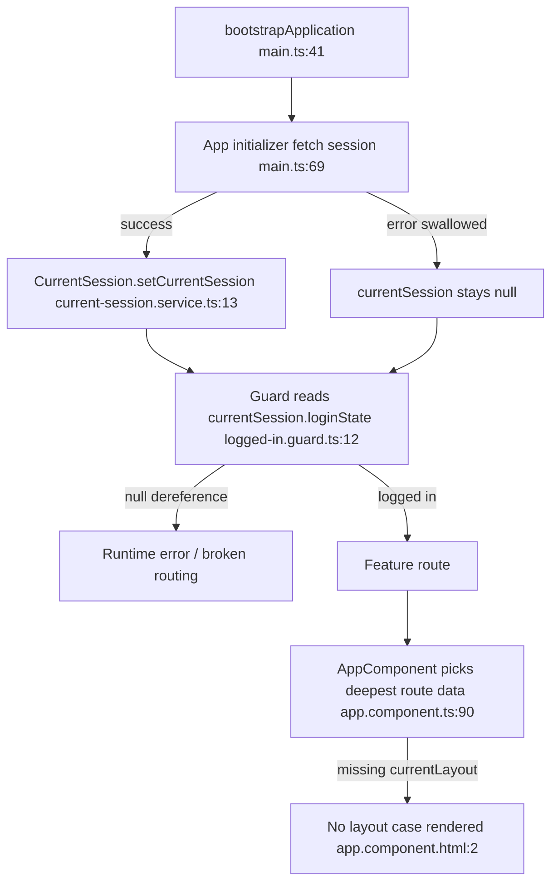

# Code Review Report

## Report Location
- Saved file: `.codex/docs/reviews/review-20260227-134652.md`

## TL;DR
- This branch performs a broad auth/session architecture shift from asynchronous session loading (`AuthenticationService`) to synchronous reads (`CurrentSession`), plus route layout handling refactors and subscriber-role mapping updates.
- I found 4 blocking regressions in session/bootstrap/layout/error-routing control flow that can cause blank pages, invalid session state, or global `/500` redirects for non-server errors.
- Merge recommendation: **request changes**.

## High-Level Change Story
- Scope: app bootstrap, auth guards, global interceptors, route layout metadata, membership selection flow, multiple feature screens that now read synchronous session snapshots.
- Intent: simplify session access by replacing observable/promise session APIs with direct synchronous reads and reduce asynchronous plumbing.
- Approach: remove `AuthenticationService`, introduce `CurrentSession` singleton, initialize session in `provideAppInitializer`, update guards/components to use `currentSession`, and add a stale-session refresh interceptor.
- Primary risk theme: the new synchronous session contract assumes `CurrentSession.currentSession` is always non-null and correctly typed, but several edge/error paths violate that assumption.

## Acceptance Criteria Status
| Criterion | Status | Evidence |
| --- | --- | --- |
| Ticket/acceptance criteria provided | unverifiable | No issue/ticket criteria were provided in this review request |
| Maintain existing auth/routing behavior | partial | regressions in [src/app/app.routes.ts:27](src/app/app.routes.ts:27), [src/app/app.component.ts:90](src/app/app.component.ts:90), [src/app/core/interceptors/redirect-on-server-error.interceptor.ts:19](src/app/core/interceptors/redirect-on-server-error.interceptor.ts:19) |
| Keep test/lint baseline green | met | `npm test -- --watch=false --browsers=ChromeHeadless` and `npm run lint` passed locally |

## Change Overview
| File | Type | Purpose | Key Change |
| --- | --- | --- | --- |
| `src/main.ts` | bootstrap module | app initialization and HTTP pipeline | added `provideAppInitializer` to fetch session; reordered/extended interceptors |
| `src/app/core/auth/services/authentication/current-session.service.ts` | service | global session store | introduced synchronous session snapshot with optional forced refresh |
| `src/app/core/auth/guards/*.guard.ts` | route guards | auth/permission routing | switched from awaited promise to direct `currentSession` dereference |
| `src/app/app.component.ts` | root component | layout shell orchestration | layout now derived from deepest active route `data.currentLayout` |
| `src/app/app.routes.ts` | route map | route metadata + membership selection resolver | converted layout from resolver-side-effects to route `data`; added resolver for `availableMemberships` |
| `src/app/core/interceptors/redirect-on-server-error.interceptor.ts` | interceptor | global server-error handling | now redirects to `/500` on any HTTP error when custom handling is absent |
| `src/app/core/interceptors/refresh-session.interceptor.ts` | interceptor | session staleness refresh | pre-request refresh of `/sessions/current` when stale |
| `src/app/features/monitoring-lists/monitoring-lists.routes.ts` | feature routes | monitoring list navigation | parent has layout data, children do not |
| `src/app/features/notifications/notifications.routes.ts` | feature routes | notification detail navigation | parent has layout data, children do not |
| `src/app/features/memberships/services/membership-access/membership-access.service.ts` | feature service | membership limit banner state | reactive stream replaced with `of(snapshot)` one-shot value |
| `src/app/core/type-to-model.ts` | model mapping | JSON:API model hydration | added complete mapping for `subscriptions` resources |
| `src/app/core/json-api-crud-service.service.ts` | data access | PATCH resource mapping | now forwards response `meta` into model mapping |

## Execution Flow Impact
### Current vs Changed Paths
| Path ID | Scenario | Current Path | Changed Path | Impact |
| --- | --- | --- | --- | --- |
| P1 | Session bootstrap and guarded navigation | `App start -> AuthenticationService.currentSessionPromise (timeout/error handling) -> guard routing` | `App start -> provideAppInitializer fetch session (errors swallowed) -> guards read currentSession synchronously` | null session now crashes guards/templates instead of controlled redirect |
| P2 | Layout selection for nested routes | `route resolves layout via `LayoutService` side-effect` | `AppComponent inspects deepest snapshot.data.currentLayout` | nested child routes without `currentLayout` become `undefined`, resulting in no rendered shell |
| P3 | HTTP error handling | `timeout/status0/5xx trigger /500 redirect` | `any error triggers /500 unless CUSTOM_ERROR_HANDLING` | 4xx business/validation errors can incorrectly route to global error page |

### Affected Code Paths
| Path ID | Code Path | Notes |
| --- | --- | --- |
| P1 | `src/main.ts:69 -> src/app/core/auth/services/authentication/current-session.service.ts:18 -> src/app/core/auth/guards/logged-in/logged-in.guard.ts:12` | initializer failure leaves `currentSession` null but guards assume non-null |
| P2 | `src/app/app.component.ts:90 -> src/app/features/notifications/notifications.routes.ts:39 -> src/app/app.component.html:2` | deepest child route has no `currentLayout`, switch falls through |
| P3 | `src/main.ts:58 -> src/app/core/interceptors/redirect-on-server-error.interceptor.ts:17 -> src/app/features/* services` | all non-custom-handled HTTP errors route to `/500` |

### Flow Diagram

## Per-File Comment Plan
| File | Risk | Review Focus | Testing Implication |
| --- | --- | --- | --- |
| `src/app/app.routes.ts` | high | resolver correctness, redirect flow, session assignment | add resolver unit test for single-membership auto-select |
| `src/app/app.component.ts` | high | layout derivation algorithm across nested routes | add route-tree layout selection tests |
| `src/app/core/interceptors/redirect-on-server-error.interceptor.ts` | high | error classification and redirect scope | add 4xx non-redirect regression tests |
| `src/main.ts` | high | bootstrap failure behavior | add initializer-failure integration test |
| `src/app/core/auth/guards/*.guard.ts` | high | null safety and fallback routing | add null-session guard tests |
| `src/app/core/auth/services/authentication/current-session.service.ts` | medium | stale semantics and refresh recovery | add `isStale` null-state tests |
| `src/app/features/memberships/services/membership-access/membership-access.service.ts` | medium | loss of reactive updates | add refresh-driven state update test |
| `src/app/core/type-to-model.ts` | low | subscription mapping completeness | retain/add mapping assertions (positive) |

## Detailed Findings (Ordered by Severity)

### 1) `issue (blocking): Membership auto-select writes the wrong object into CurrentSession`
- File: `src/app/app.routes.ts:27`, `src/app/app.routes.ts:45`
- Issue: resolver parameter `session` is the `ActivatedRouteSnapshot`, but it is passed to `currentSessionService.setCurrentSession(session)` after successful membership update.
- Impact: session store can hold a route snapshot object instead of a `Session`, breaking downstream calls like `.loginState`, `.hasPermission()`, and `.membershipId`.
- Suggested fix: capture the PATCH response and store that object.
  - Example: `const selectedSession = await firstValueFrom(sessionHttpService.update('current', ...)); currentSessionService.setCurrentSession(selectedSession)`.

### 2) `issue (blocking): Layout resolution breaks for nested routes and can render a blank app shell`
- File: `src/app/app.component.ts:90`, `src/app/app.component.ts:95`, `src/app/features/notifications/notifications.routes.ts:39`, `src/app/features/monitoring-lists/monitoring-lists.routes.ts:46`
- Issue: root component always reads `currentLayout` from the deepest active child snapshot. Many nested child routes (tabs) do not define `data.currentLayout`.
- Impact: `currentLayout` becomes `undefined`, the `@switch` in root template matches no case, and no layout content is rendered.
- Suggested fix: resolve layout by walking up parent snapshots until `currentLayout` is found (nearest ancestor fallback), or set `currentLayout` on every child route.

### 3) `issue (blocking): Initial session fetch failure now leads to null dereference instead of graceful error routing`
- File: `src/main.ts:73`, `src/main.ts:77`, `src/app/core/auth/guards/logged-in/logged-in.guard.ts:12`, `src/app/core/auth/guards/logged-out/logged-out.guard.ts:10`, `src/app/core/auth/guards/membership-selectable/membership-selectable.guard.ts:10`, `src/app/core/auth/guards/permission/permission.guard.ts:15`, `src/app/app.component.html:17`
- Issue: bootstrap initializer catches errors and only logs them; no fallback session is set. Multiple guards/templates dereference `currentSession` without null guards.
- Impact: transient backend/network failures during startup can throw runtime exceptions in routing/template execution.
- Suggested fix: either set a safe fallback session state on failure (e.g., `LoggedOut`) or reintroduce explicit null-safe guard behavior that redirects to `/500`.

### 4) `issue (blocking): redirect-on-server-error now redirects on all HTTP errors`
- File: `src/app/core/interceptors/redirect-on-server-error.interceptor.ts:17`, `src/app/core/interceptors/redirect-on-server-error.interceptor.ts:19`
- Issue: the interceptor redirects to `/500` for any error once custom handling is absent; previous filtering by timeout/status 0/5xx was removed.
- Impact: expected client-side/business errors (4xx) can unexpectedly become global server-error redirects, breaking local error UX and form flows.
- Suggested fix: restore scoped redirect conditions (timeout/network/5xx) and keep 4xx in caller-controlled handling by default.

### 5) `issue: Session staleness logic prevents recovery when session has never been set`
- File: `src/app/core/auth/services/authentication/current-session.service.ts:32`, `src/app/core/auth/services/authentication/current-session.service.ts:33`, `src/app/core/interceptors/refresh-session.interceptor.ts:14`
- Issue: `isStale()` returns `false` when `lastRefreshAt` is `null`.
- Impact: after an initialization miss, refresh interceptor does not attempt to recover the session before later requests.
- Suggested fix: treat `lastRefreshAt === null` as stale (`true`) or add explicit `currentSession == null` refresh logic in the interceptor.

### 6) `suggestion (non-blocking): Membership limit state is no longer reactive`
- File: `src/app/features/memberships/services/membership-access/membership-access.service.ts:19`
- Issue: state is emitted via `of(...)` from a single snapshot.
- Impact: session changes (e.g., post-invite/expiry updates that call `forceRefresh`) do not propagate to this banner/service unless the service is reinstantiated.
- Suggested fix: expose a reactive session stream/signal from `CurrentSession` and map it to `MembershipLimitState`.

### 7) `suggestion (non-blocking): Test coverage dropped for key permission/session behaviors`
- File: `src/app/features/notifications/pages/detail/components/notification-tabs/notification-tabs.component.spec.ts:126`; deleted files `src/app/core/auth/pages/select-membership/select-membership.component.spec.ts`, `src/app/core/auth/services/authentication/authentication.service.spec.ts`
- Issue: multiple negative-path tests were removed and critical specs were deleted during refactor without equivalent replacements.
- Impact: regressions in permission filtering and membership-selection/session flow were not caught despite a fully green test run.
- Suggested fix: add focused tests for single-membership auto-select, null-session guard behavior, nested-route layout resolution, and 4xx error handling behavior.

## Bug and Code-Smell Checklist
| Check | Result | Evidence |
| --- | --- | --- |
| Memory leak risks | no major new long-lived leak found | root subscription in `AppComponent` is app-lifetime; acceptable |
| Race conditions | **found** | session initializer failure + sync dereference path (`main.ts:73`, `logged-in.guard.ts:12`) |
| Null/undefined safety | **found** | direct dereferences without fallback across guards and templates |
| Error handling completeness | **found** | broad redirect logic and swallowed bootstrap errors |
| Dead code/unused imports | minor | `LayoutService` still injected/retained but no longer drives UI behavior |
| Magic numbers/strings | acceptable | timeout and stale constants are explicit (`10_000`, `30_000`) |
| Deeply nested conditionals | acceptable | no material complexity increase |
| Oversized functions | acceptable | changes are spread across small functions |

## Backward Compatibility
| Area | Status | Potential Breakage | Mitigation |
| --- | --- | --- | --- |
| Data/Schema | compatible | no schema changes | none required |
| API/Contracts | conditional | 4xx may route to `/500` unexpectedly | restore error filtering in interceptor |
| Jobs/Async | conditional | startup/session refresh behavior changed from resilient async to nullable sync | enforce fallback session and null-safe guards |
| Notifications/Events | compatible | no event contract changes observed | none required |
| Integrations | conditional | route-based UI shell behavior for nested feature URLs may break | inherit/fallback `currentLayout` from parent route data |

## Test Coverage Assessment
- New code tested: partial.
- Test quality: medium.
- Missing tests:
  - single-membership auto-selection resolver path writes and redirects correctly.
  - nested child-route layout resolution fallback.
  - initializer failure -> guard fallback behavior (no null dereference).
  - redirect interceptor does not route 4xx to `/500`.

## UI Design Checklist (If Applicable)
| Item | Status | Evidence |
| --- | --- | --- |
| Prior art/component reuse checked | yes | existing IX components and prior route structure reused |
| Spec fidelity (spacing/sizing/edge cases) | partial | no design spec attached in this review context |
| Responsive 320px-3000px | no evidence | not manually validated in this review run |
| Touch usability | no evidence | not manually validated in this review run |
| Accessibility (tab/focus/labels/semantic HTML) | partial | no explicit accessibility regression in diff, but not manually audited |
| Context coverage (sidebar/surfaces/etc.) | partial | potential shell regression on nested routes |
| Localization | N/A | no localization string set changes observed |
| Screenshots/videos provided | no | none attached in this request |

## Pre-Merge Checklist
| Check | Status | Evidence |
| --- | --- | --- |
| Acceptance criteria complete | partial | criteria not provided with request |
| No debug leftovers | yes | no `console.log`/`debugger` found in changed existing files |
| Tests green | yes | `npm test -- --watch=false --browsers=ChromeHeadless` passed (832/832) |
| New tests for new behavior | partial | some old tests deleted; no full replacement for key flows |
| Migrations/backfills safe | N/A | no migrations in this frontend diff |
| Query/index/pagination concerns addressed | N/A | not applicable in this diff |
| Docs/readme updated if major change | no | no docs update for session architecture change |

## Design Notes (Only Noteworthy)
- Strengths:
  - `subscriptions` resource now maps full model attributes and relationships instead of placeholder objects (`src/app/core/type-to-model.ts:197`).
  - PATCH mapping now includes response `meta`, preserving session-related metadata hydration when backend returns it (`src/app/core/json-api-crud-service.service.ts:99`).
- Concerns:
  - Core architecture now relies on synchronous global state with few defensive checks, increasing blast radius for transient startup failures.

## Suggested Review Comments (Conventional Format)
- `issue (blocking): Resolver stores ActivatedRouteSnapshot as current session`
- `issue (blocking): Nested child routes can clear currentLayout and render blank shell`
- `issue (blocking): Guard/template null dereference when initializer fails`
- `issue (blocking): Global server-error redirect catches all HTTP errors, including expected 4xx`
- `suggestion (non-blocking): Reintroduce reactive membership-limit state derivation`
- `question: Was broad 4xx -> /500 redirection intentional for this refactor?`
- `praise: Subscription and PATCH meta mappings now preserve important domain fields`

## Final File Coverage Table
| File | Risk | Commented | Why No Comment | What Is Good |
| --- | --- | --- | --- | --- |
| `src/app/app.routes.ts` | high | yes | - | clear migration away from route resolver side-effects |
| `src/app/app.component.ts` | high | yes | - | root shell logic is centralized and readable |
| `src/app/app.component.html` | high | yes | - | explicit layout switch keeps shell variants obvious |
| `src/main.ts` | high | yes | - | app initializer approach is structurally sound if null-safe guards are added |
| `src/app/core/interceptors/redirect-on-server-error.interceptor.ts` | high | yes | - | custom error handling escape hatch retained |
| `src/app/core/interceptors/refresh-session.interceptor.ts` | medium | yes | - | avoids recursive refresh on `/sessions/current` |
| `src/app/core/auth/services/authentication/current-session.service.ts` | high | yes | - | concise API (`setCurrentSession`, `forceRefresh`) |
| `src/app/core/auth/guards/logged-in/logged-in.guard.ts` | high | yes | - | guard intent remains straightforward |
| `src/app/core/auth/guards/logged-out/logged-out.guard.ts` | medium | no | same null-dereference pattern already captured in shared guard finding | consistent routing outcomes by login state |
| `src/app/core/auth/guards/membership-selectable/membership-selectable.guard.ts` | medium | no | same null-dereference pattern already captured in shared guard finding | clear state-based switch |
| `src/app/core/auth/guards/permission/permission.guard.ts` | medium | no | same null-dereference pattern already captured in shared guard finding | concise permission check |
| `src/app/features/notifications/notifications.routes.ts` | high | yes | - | parent route metadata and guard composition are clear |
| `src/app/features/monitoring-lists/monitoring-lists.routes.ts` | high | yes | - | child route intent is organized and readable |
| `src/app/features/memberships/services/membership-access/membership-access.service.ts` | medium | yes | - | membership limit derivation logic itself is clean |
| `src/app/core/type-to-model.ts` | low | yes | - | improved domain mapping completeness |
| `src/app/core/json-api-crud-service.service.ts` | low | no | low-risk, targeted fix validated by inspection | better parity with backend response metadata |
| `src/app/features/notifications/pages/detail/components/notification-tabs/notification-tabs.component.spec.ts` | medium | yes | - | still validates primary tab rendering paths |
| `src/app/core/auth/pages/select-membership/select-membership.component.spec.ts` | high | yes | - | N/A (file removed; replacement coverage needed) |
| `src/app/core/auth/services/authentication/authentication.service.spec.ts` | high | yes | - | N/A (file removed with service deletion) |

## Review Comment Inventory
| ID | Label | Severity | File:Line | Comment | Suggested Change |
| --- | --- | --- | --- | --- | --- |
| C1 | `issue (blocking)` | high | `src/app/app.routes.ts:45` | Resolver stores route snapshot as session model in single-membership path | Use PATCH response (`selectedSession`) in `setCurrentSession` |
| C2 | `issue (blocking)` | high | `src/app/app.component.ts:95` | Layout picks deepest route data only; nested children lack `currentLayout` | Walk up parents for first defined `currentLayout` or define on all children |
| C3 | `issue (blocking)` | high | `src/app/core/auth/guards/logged-in/logged-in.guard.ts:12` | Null session dereference when initializer fetch fails | Add null-safe guard fallback (`to500`/`toLogin`) and/or fallback session state |
| C4 | `issue (blocking)` | high | `src/app/core/interceptors/redirect-on-server-error.interceptor.ts:19` | Redirect now triggers for all errors, including expected 4xx | Reintroduce `status === 0 || status >= 500 || timeout` predicate |
| C5 | `issue` | medium | `src/app/core/auth/services/authentication/current-session.service.ts:33` | `isStale()` false when never refreshed | Return `true` when `lastRefreshAt` is `null` |
| C6 | `suggestion (non-blocking)` | medium | `src/app/features/memberships/services/membership-access/membership-access.service.ts:19` | One-shot `of(snapshot)` prevents updates after refresh | Map a reactive `CurrentSession` stream/signal |
| C7 | `question` | low | `src/app/core/interceptors/redirect-on-server-error.interceptor.ts:19` | Was broad 4xx redirection intentional? | Confirm intended UX for validation/client errors |
| C8 | `praise` | low | `src/app/core/type-to-model.ts:197` | Subscription mapping now preserves role/priorities/membership relation | Keep this mapping and add regression test if missing |

## Final Verdict
- **Request changes** (blocking issues C1-C4).
